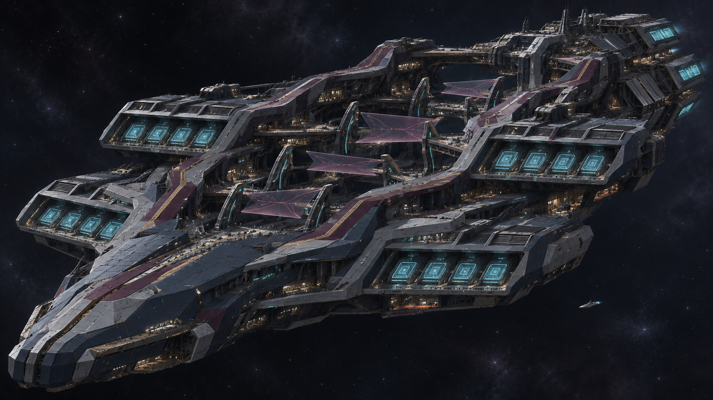
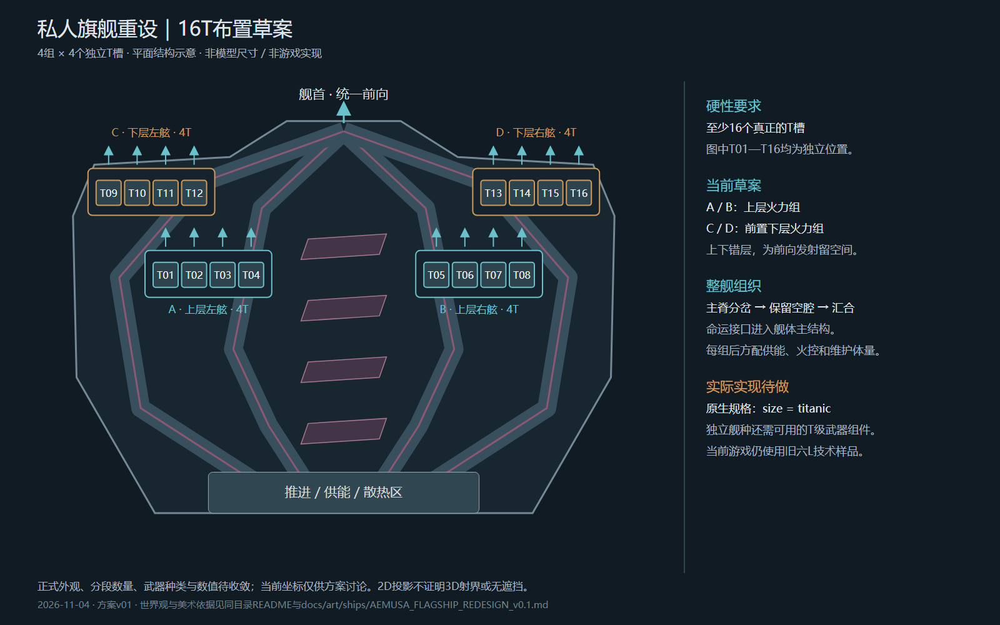

# 私人旗舰整舰重设：首稿与16T布局

2026-11-04。根据用户已明确的“整舰重新设计、足以支撑命运主题、至少16个T槽”制作。当前状态为`draft_pending_human_review`；旧v08仍只作为技术样品，游戏中的16T尚未实现。

## 完整概念

这是内置image_gen生成的整舰概念，1672×941。四条有厚度的主结构从推进区分开、绕过错层开放空间，再向舰首汇合；四组大型发射阵面承载16个候选T位。中央四片受控观测面与路径关系用于表达可能性的展开与选择。

深蓝灰、雾银和公共维护结构延续中央庭工程底座；酒红／暗紫及少量淡金集中在主要路径和观测空间。小型伴随舰只提供相对尺度线索，不是新增舰种、指定公里数或已确定倍率。

近景维护细节较密，舰首仍有明显楔形特征；后续需结合整体反馈收敛。后部冷青矩形属于推进端候选，不计入16T。概念未作为正式模型、贴图、剧情事实或发布素材接入游戏。

## 可计数的布局

[SVG源](layout_16t_v01.svg) · [结构数据JSON](layout_16t_v01.json) · [完整方案](../../../docs/art/ships/AEMUSA_FLAGSHIP_REDESIGN_v0.1.md)

图中T01—T16为16个独立位置，四组各四个，上下错层。结构数据使用`size=titanic`的原生模板作为参照，不能以X／L槽替代。示意坐标不是建模单位，平面图也不证明3D无遮挡或实际射界。

已经只读核对本机`invisible_titanic_fixed`、原生泰坦区段和`PERDITION_BEAM_TITAN`。原版武器的舰种白名单不包含我们的独立旗舰，因此后续还要接入本舰可用的真正T级组件；只改槽位名称并不完成16T实现。四组是结构布局，不承诺分组操作UI或编排齐射。

## 生成与来源

- 工具：内置`image_gen`，非API／CLI；没有上传原作图片、旧舰图或第三方模型。
- [完整生成提示词](prompt_v01.md)。图像从默认输出复制进本目录，原始输出保留。
- 原始文件：`C:\Users\Admin\.codex\generated_images\01a0dc98-74e4-7ed1-b4ed-cded44fd25b9\exec-3df8ef55-b3e0-4b28-87ce-bc3d0c7bd48f.png`。
- 原作／项目／设计层级分别记录于[方案](../../../docs/art/ships/AEMUSA_FLAGSHIP_REDESIGN_v0.1.md)和[风格约束](../../../docs/art/REALITY_ASSET_LORE_STYLE_BINDING.md)。本轮数据库只读查询，来源审核状态未改。
- 布局由[脚本](../../../tools/art/build_flagship_redesign_layout_v09.py)确定性生成SVG／JSON，再以独立无窗口Edge渲染为PNG；使用仓库临时配置，仅读取本地SVG，未使用用户浏览器配置。
- 16个独立标识、四组数量、SVG结构、PNG尺寸及实际渲染均已核对；两个分组标签与箭头的遮挡已修正。

本轮没有运行旧模型构建、游戏或用户Blender，没有修改`mod/`、存档和暂停原型。三个旧共享DDS重名问题仍在技术待办，不作为整舰概念工作的前置。

下一步按完整舰体的反馈收敛方向，再制作新的整体灰模、16个发射位置与可用T组件。具体外观、规模、武器种类／数值和分段方式仍未定稿。
