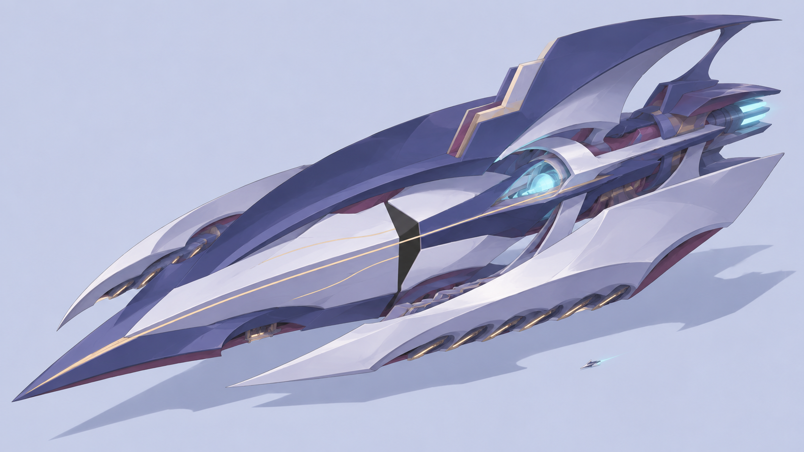
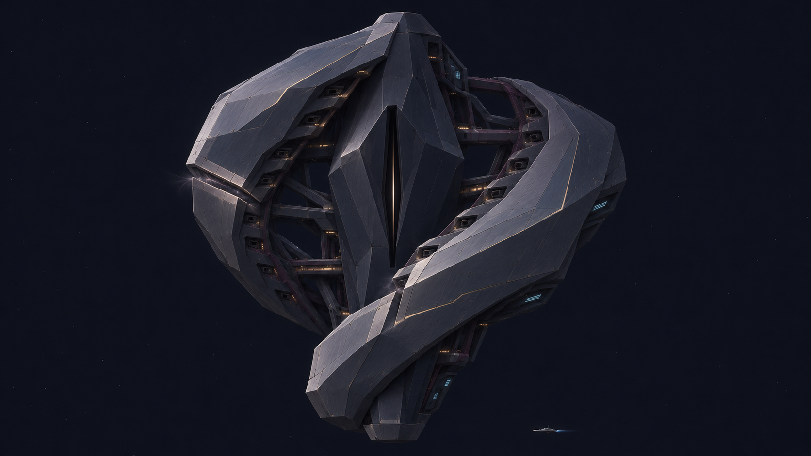

# 命运旗舰：七都风格校准与结构探索

## 最新反馈与风格校准

用户回答三稿方向问题：“这几个我觉得没有七都的美术风格”。不视为选择A；A2暂不沿原写实方向深化。核对本地七都官方宣传图4／5、已登记的原作器物与设计稿后，发现此前提示词多次主动要求近照片写实、硬表面物理材质；深蓝灰公共校准只是项目规范，不能代替原作美术表达。

[完整提示词](prompt_style_probe_v01.md) · [来源、判断及检查点](../../../reports/flagship_style_recalibration_2026-11-05.json)

本稿改用清楚轮廓、大色块、绘画式明暗、选择性细节与连贯曲面，研究原作器物的整体设计感。没有上传原作参考图，没有复制角色或神器形状；内置image_gen全新生成，1672×941。PNG完整性与文件引用已核对。

当前只是`style_calibration_pending_user_feedback`：画面表达已改变，但造型仍偏轻快，巨型体量与命运主宰的权威感没有解决，不是旗舰定稿或原作星舰。16T要求保留，未建模、未写入游戏。下一步先听取风格反馈，再落实超级旗舰的体量与空间组织。

## A2结构探索（前一轮记录）

2026-11-05。用户要求继续昨晚工作。A／B／C尚未选定；助手询问方向后，暂以A作为一次结构探索的起点，不记录为用户批准A。

[完整提示词](prompt_a2.md) · [昨晚三稿](../aemusa_flagship_redesign_20261104/README.md) · [本轮检查点](../../../reports/flagship_a2_structure_checkpoint_2026-11-05.json)

## 本轮实际变化

- 保留纵向主轴，四个独立方盒舱体改成围绕主轴展开的两侧连续错位外壳。
- 将几何断口纳入实体轮廓，收敛跨越背景的轨迹光效。
- 武器开口退入内缘，16T继续作为工程容纳要求，不作为16个大亮窗主导整舰。

## 当前判断

主体比A更连贯，移动平台的拼装感有所减少，弱光效下也有明确形体。舰首和推进方向仍不够明确；命运主宰气质是否符合期待由用户评审。当前`draft_pending_human_review`，没有新灰模、运行模型、16T实现或面数预算变更。

内置image_gen以[项目自生成A图](../aemusa_flagship_redesign_20261104/round03/concept_a_axis.png)为唯一编辑参考，输出1672×941。原始文件`C:\Users\Admin\.codex\generated_images\01a1a698-2daa-7032-a7ad-e2711313ad3d\exec-826af977-e3aa-4b50-b3ca-6c7351983a6d.png`保留；项目副本PNG完整性核对通过。未操作游戏、用户Blender或独立暂停原型。

下一步按反馈确定是否继续这个轮廓；若继续，优先明确航向、推进和实体层级，再进入灰模。
