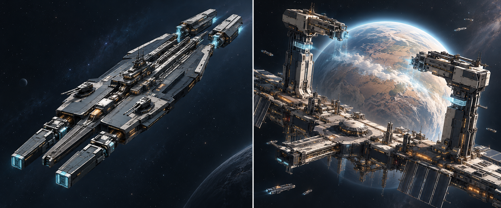

# 中庭级与造境平台：成品观感概念板

2026-10-31，状态：`concept_preview_only_pending_review`。用户在结束当天具体开发后要求查看完成观感，并明确概念图即可；本批只生成概念展示和保存记录。

使用内置`image_gen`，以现有两张公共配色研究图为功能布局参照，生成一张舰船/平台双栏概念板。[完整提示词](prompt.txt)。左侧中庭级战略舰，右侧传承造境平台运行态；深蓝灰工程主体、雾银结构、冷青运行端与琥珀维护侧沿既有公共方向。

这是完成观感的绘图探索，不是现有Blender模型、游戏截图或实装证据。图中结构细节、比例、武器数量和场效不自动变更源码或模型；具体外观仍待反馈，正式几何、贴图、LOD、效果和游戏接入另行制作。原灰模及配色研究保留。

原始生成文件保留在Codex生成图片目录，本目录保存副本；未触及游戏、存档或用户交互场景。今晚以概念展示与保存收尾。
