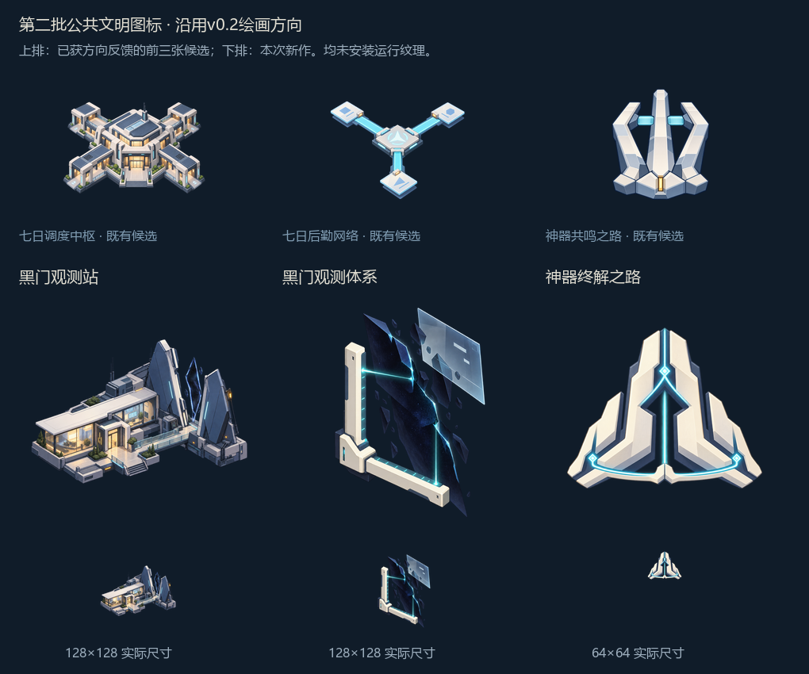

# 第二批公共文明图标候选

2026-10-14。用户对v0.2说“很好，继续吧”，据此沿用绘画方向扩展三张；这是方向的正向反馈和继续制作授权，不自动等于本批外观、全部图标或游戏显示验收。

## 本批内容

| 候选 | 用途与构图 | 对应GFX／尺寸 |
| --- | --- | --- |
| 黑门观测站 | 不对称城市研究站、暖灯门厅与步道，传感翼板面向局部暗色异常 | `GFX_building_artifact_black_gate_observatory`／128×128 |
| 黑门观测体系 | 两个测量方向、异常边界与错位数据平面，区别于建筑主体 | `GFX_tech_artifact_black_gate_observation`／128×128 |
| 神器终解之路 | 承接共鸣的三支框架，改为宽折面、连接带和向上负形；文明制度的整合进阶 | `GFX_ap_artifact_user_apotheosis_path`／64×64 |

造型均为本Mod新设计，不是七都原作已有设施或标志。依据现有建筑、公共科技、公共飞升的用途及[异常表现规范](../../../docs/art/reference_library/moodboards/OTHERWORLD_AND_ASTRAL_RIFTS.md)，没有新增玩法或原作事实。终解之路属于公共文明，不是爱缪莎个人终解。

## 制作与观察

- 使用内置`image_gen.imagegen`逐张生成三张初稿，无图片输入；公共风格、禁止段及v0.2的抽象绘画观察均写入完整提示词。原作图片未上传。
- 终解飞升初稿偏大型建筑，已作一次定向编辑，删除地基、窗格，转为三翼连接徽记。编辑输入只有本项目初稿；初稿保存在`iterations/`，未覆盖。
- 米白、冷蓝阴影与少量青光延续上一批。观测站保留城市使用感；科技用测量结构与暗面表达研究对象；终解的宽轮廓和连接关系与共鸣初段可区分。
- 待收敛点：观测站中的异常仍偏细长晶片，科技暗面仍有实体碎片感与偏多细节；不将这两项解释为原作黑门的定型形态。观测站的小窗／植被、科技的细碎边缘在128像素会合并，当前轮廓承担主要识别。飞升在64像素保留三翼形，但仍有厚片结构感，非最终标志验收。

## 保存与检查

- `sources/`：三张透明母版；`generation.json`：完整中文提示词、工具回传路径及飞升编辑来源；`exports/`：128／128／64像素透明PNG与未压缩RGBA8 DDS。
- 三张母版均为RGBA，透明度范围含0及255；三项DDS回读与导出PNG逐像素一致，目标尺寸与既有运行DDS一致。文件哈希、对应键、运行文件在导出期间未变化的哈希见`exports_manifest.json`。
- Python只用于等比导出、审阅板排版与格式检查，没有程序代绘。重新导出：`python art/icons/milestone4_batch02/export_samples.py --pillow-dir temp/icon-python`。
- `mod_path`在资产登记中保持为空；未安装运行纹理，未操作游戏，未重复历史机制验证。状态为`draft_pending_human_review`。

按不同目标计数，当前已有建筑2／15、公共科技2／19、公共飞升2／2的绘图候选；v0.1与v0.2修订不重复计数。遗留科技、个人飞升／未来个人研究、传统及其余界面类别另列，整套图标仍未完成。

当前优先已调整：用户确认先补[完整科技与建筑路线](../../../docs/design/artifact_civilization_research_building_route_v0.2.md)，再继续大量画图标；批量制作暂停。六个目标候选保留，黑门晶片／碎片感随对应资产批次收敛；当前2／15与2／19只是旧框架覆盖，不是扩展后总进度。实际界面检查放在确定候选并接入资源时进行。人物组合暂停，跨星系巨构保持计划状态。
