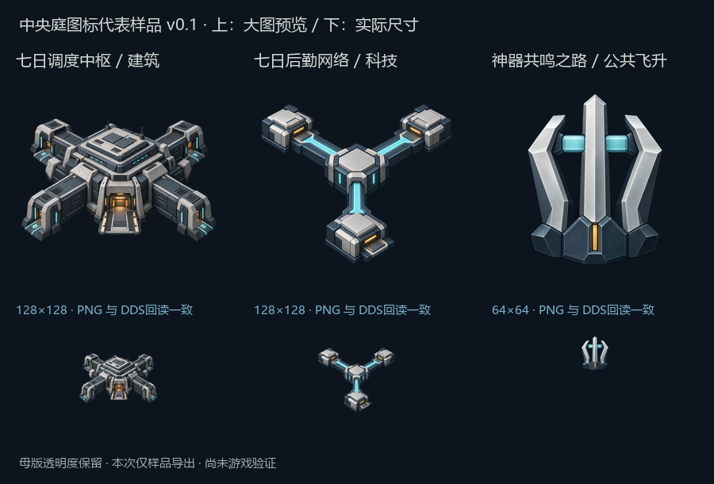

# 中央庭图标代表样品 v0.1

2026-10-12。用户要求开始正式图标制作后，先交付建筑、科技、公共飞升三个代表样品。采用内置 `image_gen.imagegen` 生成，每个图标单独调用；没有用程序绘图替代母版。样品为 `draft_pending_human_review`，运行Mod仍保留已有纹理，游戏画面未验证。

| 样品 | 功能与轮廓 | 对应引用键 | 导出规格 |
| --- | --- | --- | --- |
| 七日调度中枢 | 公共疏散、避难和调度；四向桥接设施、可见暖色门厅 | GFX_building_artifact_seven_day_command | 128×128 RGBA8 DDS／PNG |
| 七日后勤网络 | 疏散、补给与记录组织成网络；分支路径与三处节点 | GFX_tech_artifact_seven_day_logistics | 128×128 RGBA8 DDS／PNG |
| 神器共鸣之路 | 文明将契约、生产和部署整合为共同制度；向上汇合的三支结构 | GFX_ap_artifact_user_resonance_path | 64×64 RGBA8 DDS／PNG |

配色依据中央庭公共视觉规范：蓝灰结构、雾银表面、冷青导向与少量琥珀入口光。公共图标不使用爱缪莎个人塔罗、星月或形态符号。三个样品靠主体构成区分，后续个人专属批次另读人物规范。

- 母版：`sources/` 下三张1254×1254透明PNG；原生成文件复制入仓库，未覆盖或裁切母版。
- 完整提示词、工具及来源记录：[generation.json](generation.json)。原图像输出目录仅为生成入口，项目副本已保存。
- 尺寸样品：`exports/`，每项一个原引用尺寸PNG与未压缩RGBA8 DDS。等比缩放并加透明留白，保持母版通道；原运行图为全不透明，新的透明呈现需在后续新增显示检查中确认。
- 规格与哈希：[exports_manifest.json](exports_manifest.json)。DDS回读与尺寸PNG逐像素一致，尺寸和透明度断言通过。审阅板下排按真实像素尺寸显示，上排为放大图。
- 本轮观察：四向建筑、分支网络和纵向飞升的轮廓能够区分；小图仍需用户反馈和实际游戏背景验证。没有把大图精细度或文件导出称为游戏验收。

重新导出：在已安装Pillow的Python环境中执行 `python art/icons/milestone4_v01/export_samples.py`；本机临时依赖位于忽略目录 `temp/icon-python`，可追加 `--pillow-dir temp/icon-python`。此脚本只导出尺寸、排版审阅板与回读检查，不制作或修改母版造型，不写入Mod。

本次只完成三个代表样品；15座建筑、19项公共科技、其余公共飞升及传统／其他界面图标仍按资产计划扩展，旧科技和个人路线继续分开。尚未安装运行纹理，未操作群星或重新执行C2测试。下一步依据这三类样品的具体反馈统一或调整风格，再做整批；未启动巨构验证、模型制作或专属科技设计。
