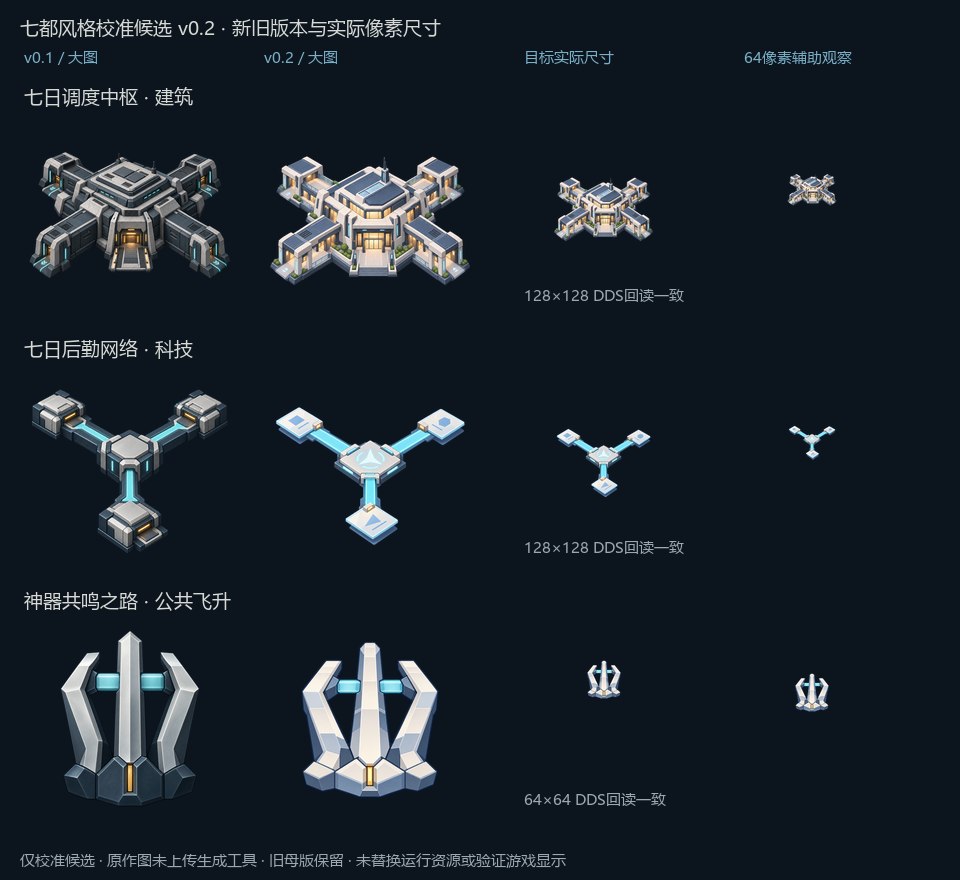

# 七都风格校准候选 v0.2

2026-10-14。接续用户“校准一下”的要求，已完成七日调度中枢、七日后勤网络、神器共鸣之路三张校准候选。使用内置 `image_gen.imagegen` 编辑本项目v0.1；后两张同时参考本项目新中枢v0.2的表现。原作图片仅作本地观察，没有上传生成工具。状态为 `draft_pending_human_review`，未安装运行纹理，未做游戏显示检查。

## 来源核实与使用方式

- [网易官网](https://f7.163.com/)的HTML直接引用 `fc.res.netease.com/pc/fab/20191219174338/img/tese1～5` 特色图，实际下载成功并查看。第4图中的城市战斗场景、第5图中的都市对话场景可支持块面、轮廓与城市空间观察，第3图包含原作角色界面。它们是宣传合成图，不能当作独立建筑设定图。
- [网易在App Store的介绍](https://apps.apple.com/cn/app/id1141273107)明确使用现代都市与2.5D Anime的表述；这提供总体方向，不自动决定本Mod建筑造型或图标。
- 新登记 `REF-OG-OFFICIAL-FEATURE-001～005`，均为辅助参考，不是人工批准主锚点；原图只保存在Git忽略目录。URL、SHA256和用途边界见[核实记录](reference_verification.json)。
- 旧地区联系表的逐格来源尚未解决，`REF-PROJECT-CENTRAL-001`继续保留 `source_uncertain`，没有用它确认原作风格。原先误列为原作的地区生成图 `REF-PROJECT-CENTRAL-002` 已纠正为项目产物；不再用生成图反证原作风格。
- 生成工具的图片输入只有本项目母版；官网画面转译为抽象的绘画观察，不复制原作建筑、角色、界面、徽记或宣传构图。本图标仍是Mod原创设计，不能称为七都原作已有设施／飞升图标。

## 三张的校准结果

| 项目 | v0.2相对v0.1的变化 | 保留与限制 |
| --- | --- | --- |
| 七日调度中枢 | 薄化外墙和边条，加入开放门廊、玻璃、暖色窗光与小块绿化；减少格栅和拉丝 | 保留四向公共协调功能；128像素轮廓可辨，细小绿化不承担功能识别 |
| 七日后勤网络 | 仓库状端点改为信息片，中心改为调度记录板；减少厚重机壳，明暗更简练 | 保留一个中心连接三个端点；路径仍偏亮，后续可根据实际界面反馈调整 |
| 神器共鸣之路 | 米白／冷蓝平涂块面、钝化顶端，削弱写实金属纹理和暗色基座 | 保留原三支上升框架；仍有柱状结构感，本轮是表现校准候选，不能称新飞升标志定稿 |

本轮观察到建筑的公共生活感增强、科技与建筑的主体表达拉开、飞升块面更清楚。是否符合用户希望的七都气质仍待具体外观反馈；不写为美术通过，也不直接扩展整批。

## 保存与验证

- 母版位于 `sources/`，完整提示词、编辑目标和本项目风格参考见[generation.json](generation.json)。
- 导出仍对应原GFX键；建筑128×128、科技128×128、公共飞升64×64，透明PNG及未压缩RGBA8 DDS位于 `exports/`。
- DDS回读与目标PNG逐像素一致，三张母版透明度均包含0和255；旧v0.1三张来源SHA256与既有登记一致。证据见[导出清单](exports_manifest.json)。
- 对照板放大图与实际尺寸分开，64像素只作辅助观察；不将离线尺寸检查说成游戏显示通过。原运行纹理保持原状，公共／个人科技继续分开，C2及其他历史机制未重测。
- 参考索引生成检查为52条记录、0错误、23警告；警告涉及原有来源、爱缪莎旧路径缺失及未审核条目，本轮未把它们抹平为通过。

重新导出：`python art/icons/milestone4_v02/export_samples.py --pillow-dir temp/icon-python`。Pillow用于等比尺寸导出、对照排版和DDS回读，未用程序重绘或覆盖母版。

后续先依据三张候选的具体反馈收敛样式，再进入其他建筑、科技、飞升、传统等图标批次。巨构、人物组合与个人科技设计不在本次范围。
