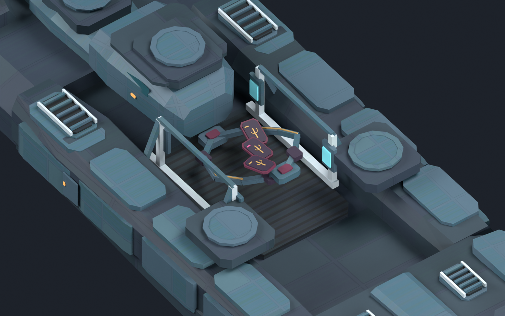

# 现实恒定旗舰／基线枢纽：世界观与风格落实v08

2026-11-03，基线`bc8274a`。本候选已接入开发版`mod/gfx/models/aemusa_reality_identity_v08/`，具体外观仍为`draft_pending_human_review`，尚未实际进游戏观察。本轮先查七都数据库并阅读实际来源，按[世界观与美术约束](../../../docs/art/REALITY_ASSET_LORE_STYLE_BINDING.md)继续v07；没有改写角色设定或危机机制。

## 造型与身份

- 旗舰保留中央庭工程主体。中央作业井内用两条错层、分叉后汇合的仪轨与三枚可数的牌式观测界面，表达爱缪莎的计算、可能性和选择。暗紫、酒红、淡金和低强度玫红只用于局部接口；个人色的具体数值属于本次候选。
- 观测界面是工程视觉表达，不是可量产的塔罗神器，也不代表已获得命运主宰的终局能力。当前是静态常态姿势，翻牌、运动轨迹和启动动画均未实现。
- 枢纽保持公共专业工程：四向观测孔口、封装分析舱、中央资料抽屉及可检修数据通路。两阶段共216个基础对象，新增观测安装板有实体横梁支撑。
- 六个炮位完整亮圈改为涂层金属，保留原炮位形状与全部挂点，使个人接口成为局部焦点。炮塔仍由原生组件挂接，离线图不烘焙炮管。



[整舰](previews/flagship_oblique.png) · [侧视](previews/flagship_side.png) · [无个人色／发光的几何图](previews/flagship_geometry.png) · [枢纽基址](previews/baseline_base.png) · [枢纽运行态](previews/baseline_active.png)

以上是实际Blender模型的离线图。个人接口在整舰视角占比有限，整体细节仍简化；正式曝光、最终外观与实际炮塔／效果组合尚未确认。

## 生产与接入

| 部件 | 主网格三角面 | 实际材质 |
| --- | ---: | --- |
| 旗舰舰首 | 1644 | 公共v05图集 |
| 旗舰中段 | 2896 | 上半公共8格＋下半局部个人格 |
| 旗舰舰尾 | 2348 | 公共v05图集 |
| 枢纽基址 | 4364 | 公共v05图集 |
| 枢纽运行态 | 7228 | 公共v05图集 |

旗舰合计6888主网格三角面。每网格仍只有一个材质；公共三DDS为2048×1024，私人中段三DDS为2048×2048，均BC3、12级mip。私人图集的上半部来自公共图集，BC3重新编码可能产生量化差异，不能声称其与旧DDS逐字节一致；其他四个部件直接复用原公共DDS。

作者源[reality_identity_v08.blend](reality_identity_v08.blend)保持+Y舰首、+Z上方；已重开并打包6张DDS，无外部Blend库。15份含独立简化替代的PDX均回读通过；只有5主网格安装到Mod，自动LOD未接入。

运行目录含5网格、6DDS和7个实体定义（含一套仅供受控显示的组合实体）。三份消费者文件共改8处`entity`／`construction_entity`；非图形AST与原提交一致，武器槽、获取条件、费用、冷却、建造时间、唯一性与资料状态保持。新增12条资产登记均为开发候选，未标记正式外观或发布批准。

[离线清单](identity_manifest.json)记录制作阶段的未安装状态；当前接入事实以[接入结果](../../../reports/reality_identity_v08_integration_2026-11-03.json)为准。总静态检查274脚本、261事件、2271本地化键，0错误／0警告；这不等于运行通过。

## 本轮断点修复

Blender的`//export/file.dds`被Windows `Path`误当成UNC共享根，导致公共贴图路径丢失文件名；已改为先用`bpy.path.abspath`解析。打包数据始终保留，修复后从保存源继续导出，未重跑建模和六图渲染。

目视检查补了观测安装板的四根横梁。源文件载入时枢纽集合隐藏，须先启用依赖图再读取变换；横梁方向已核对。只刷新两张受影响枢纽图，旗舰及其四张图保留。所有本轮后台会话已经结束，没有待执行游戏输入。

## 复现与下一步

```powershell
& 'G:\python\python.exe' -X utf8 -B tools/art/prepare_reality_identity_v08.py
& 'G:\blender\blender.exe' --background --factory-startup --python-exit-code 1 --python tools/art/build_reality_identity_v08.py -- --pdx-addon-root 'C:\Users\Admin\AppData\Roaming\Blender Foundation\Blender\5.1\extensions\user_default'
```

仅确需重建时执行，不是续接待办。脚本独立后台运行，不连接用户Blender。`--resume-export`可从本候选保存源继续导出；成功接手后不要再跑修复或重建命令。源制作脚本不会自动覆盖运行目录。

下一步为一次约20分钟的代表实机观察：仅本Mod、先核实实时进程和播放集，观察现有私人旗舰的尺度／六L炮塔与尾焰、枢纽阶段模型及轨道位置。原恢复／占领暂停机制已有证据直接复用，不逐窗存档、不恢复旧命令。具体外观和材料继续根据实际画面收敛；人物组合、批量图标、独立连续巨构继续暂停。
