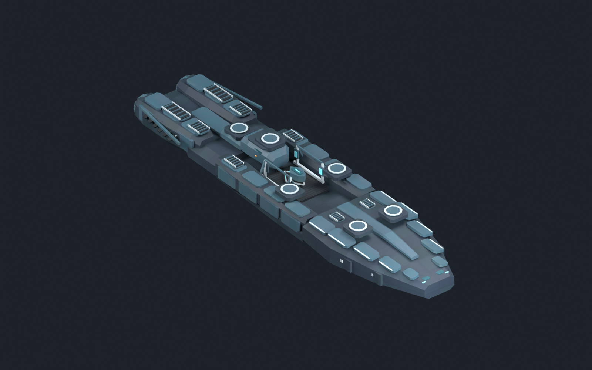
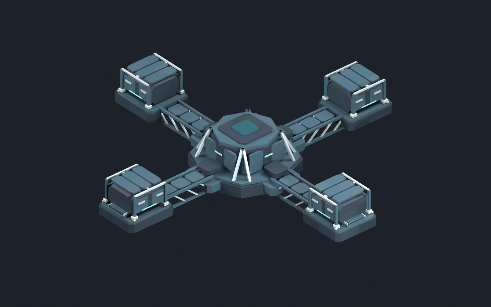

# 现实恒定旗舰与基线枢纽：结构精修候选v07

2026-11-03，基线`1853b00`。状态为`draft_pending_human_review`，未安装到游戏。这是私人旗舰与危机枢纽的首轮结构精修，保持[既有五部件方案](../../../docs/art/MILESTONE4_VISUAL_PROPOSAL.md)与v06接口；公共中庭级、传承造境平台及旧舰／旧塔均保持独立。

## 本轮变化

- 旗舰：厚度变化的钝楔舰首、分段斜肩与侧舷护板；中央开放作业井、成对作用端及分叉／汇合的局部仪轨；低矮指挥舱、双推进舱、凹入喷口和独立换热叶。六个L槽的承载座可见，实际炮塔仍由原生组件挂接，离线图没有烘焙炮管。
- 枢纽：四向支臂改为带斜腹杆的桁架，基址露出中央设备井和安装架；运行态加装中枢资料舱与封装分析舱。两阶段共184个基础对象的几何、UV和变换完全一致，升级不挪动基础。
- 材质：沿用v05三张共享DDS，未改色板或发光通道。前四张图的灯光、相机和曝光设置与v06一致，差异来自模型及材料分区；不是游戏截图。

| 部件 | 主网格三角面 | 简化替代1／2 |
| --- | ---: | ---: |
| 旗舰舰首 | 1644 | 822／378 |
| 旗舰中段 | 2100 | 1050／482 |
| 旗舰舰尾 | 2348 | 1174／540 |
| 枢纽基址 | 3532 | 1766／812 |
| 枢纽运行态 | 5340 | 2670／1228 |

旗舰三段合计6092三角面。独立简化网格并未接入引擎自动LOD，不能用文件数量宣称游戏性能或远景显示已通过。

## 实际模型预览





[旗舰侧视](previews/flagship_side.png) · [恒定装置近景](previews/flagship_device.png) · [枢纽基址](previews/baseline_base.png)

这轮已改善长方体堆叠和阶段差异，整体细节仍简化；具体外观、最终材质曝光与实际炮塔组合均未定稿。

## 文件与检查

- [作者源](reality_refinement_v07.blend)：+Y舰首、+Z上方；已实际保存并重开，打包3张DDS，无外部Blend库。
- [清单](refinement_manifest.json)：5主网格、10独立简化替代、7实体样品、5张1600×1000预览。
- `export/`：船用导出副本已转换为原生PDX负Z舰首，15份PDX均实际回读；六L武器、两推进点和枢纽接口的位置／旋转与v06一致。
- [必要检查结果](../../../reports/reality_refinement_v07_validation_2026-11-03.json)：GFX／实体结构及引用、2048×1024 BC3／12级mip、PNG和共享基础通过。未跑旧剧情或全项目玩法回归。

构建日志的10条`No mesh data to join`出现在单个已合并网格的简化导出步骤；对应10份文件均成功导出回读且面数减少，不是未产出模型。后台构建正常退出，无待续接进程或游戏输入。

## 复现与下一步

```powershell
& 'G:\blender\blender.exe' --background --factory-startup --python-exit-code 1 --python tools/art/build_reality_refinement_v07.py -- --pdx-addon-root 'C:\Users\Admin\AppData\Roaming\Blender Foundation\Blender\5.1\extensions\user_default'
```

仅在确需重建本候选时执行；接手不默认重跑。独立后台不连接用户打开的Blender。源文件保留作者坐标，原生方向转换发生在保存后的导出内存副本；v06原文件不写回。

下一步按本组实际预览收敛具体外观，再合并一次运行接入与代表观察。游戏尺度、炮塔／尾焰／死亡效果、自动LOD仍未验；原唯一舰恢复与枢纽占领暂停规则复用，不重测全部剧情。人物组合、批量图标、独立连续巨构继续暂停。
