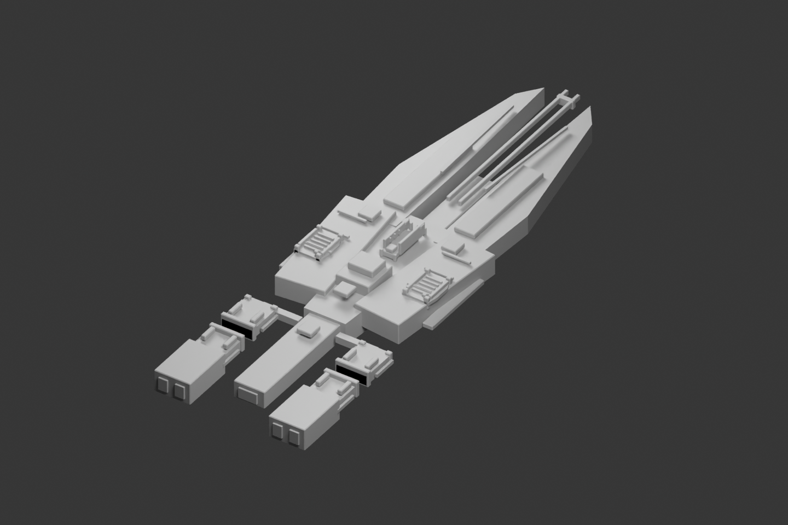
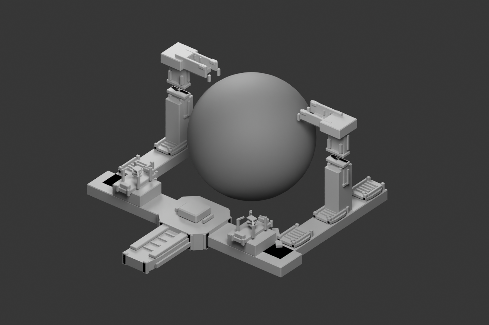

# 中庭级战略舰与传承造境平台完整灰模候选 v0.1

2026-10-31，`draft_pending_human_review`，`runtime_installed=false`。本批将[公共Kit](../central_court_kit_v01/README.md)应用到完整舰体和两阶段巨构；这是外观候选，未定稿或安装。



## 中庭级战略舰／F07炮击代表

长双叉围出中轴脊炮通道，肩部为炮位、装甲与维护面，尾部两侧是通过成对接口维持关系的分离式推进舱。舰桥和观测设备保留人类工程用途。三段共用原点，当前仅覆盖F07的1X＋炮击中段/舰艉代表；旧2L舰首和航母等外观组合还未制作。

舰首`xl_gun_01`、中段3个`large_gun_*`、舰艉1个大型炮位及2个主推进定位器按现有区段命名。这里只核对名称和PDX可读性，朝向、开火/推进与游戏尺度仍待接入验证。舰体共4132三角面。[顶视](previews/cruiser_top.png)。

## 传承造境平台



后部施工平台连接两条开放支架；[基址](previews/worldformer_foundation.png)保留供给、维护与待展开基座，运行态增加双侧作业端、测量架和核心框。共同基础布局由同一构建函数保持。球体仅是建模比例参照，不在PDX导出中；实际天体大小、轨道偏移与平台比例须在游戏匹配，不能把此图当成已实现环抱天体效果。

| 导出网格 | 三角面 | 定位器 |
| --- | ---: | --- |
| `cc_candidate_cruiser_bow` | 328 | xl_gun_01 |
| `cc_candidate_cruiser_mid` | 2360 | large_gun_01, large_gun_02, large_gun_03 |
| `cc_candidate_cruiser_stern` | 1444 | engine_large_01, engine_large_02, large_gun_01 |
| `cc_candidate_worldformer_base` | 3532 | build_point, planet_focus |
| `cc_candidate_worldformer_active` | 6996 | build_point, planet_focus |

## 源文件与验证

[Blender源文件](central_court_full_candidates_v01.blend)、[实际清单](candidate_manifest.json)和[磁盘重开结果](saved_blend_check.json)。五网格均PDX回读通过、每网格一个材质；新源文件重开后核对网格/定位器，无外部Blend库。共享3张项目灰贴图，`export/_central_court_candidates.gfx`为注册样品。

本批28次复用公共Kit部件，新增舰体/支架几何。原版只在独立参照场景中读取；候选构建重新factory-startup，仅追加项目Kit、验证数据已本地化并移除来源弱引用。原版网格/纹理未纳入候选文件。源文件含可隐藏的自建天体参照球，默认展示整舰。

与[原版的局部比较](../../../docs/art/reference_library/VANILLA_VISUAL_COLLISION_v0.1.md)已记录，全面避撞、正式材质、LOD、实体与效果、实际游戏表现仍待完成。三个ship_size区段与F08玩法脚本、数值及资格均未更改，游戏资源未替换。

## 重建

仅独立后台factory-startup，拒绝在用户交互场景或已打开文件中运行。沿用本机已安装io_pdx_mesh：

```powershell
& 'G:\blender\blender.exe' --background --factory-startup --python-exit-code 1 --python tools/art/build_central_court_candidates.py -- --pdx-addon-root 'C:\Users\Admin\AppData\Roaming\Blender Foundation\Blender\5.1\extensions\user_default' --mode both
```

`--mode references`只生成本机原版参照；`--mode candidates`只重建候选。Python异常以非零退出码结束，且必须取得`FULL_CANDIDATES_OK`与磁盘核对文件才记为完成。下一步按整体轮廓反馈收敛比例和功能区，再做材质/LOD及必要游戏显示；旧样品继续保留。

## 公共配色研究

另存[材质研究v0.1](material_study_v01/README.md)，沿用批准公共配色；原灰模保留，具体外观仍待评审，尚未制作正式游戏贴图。
