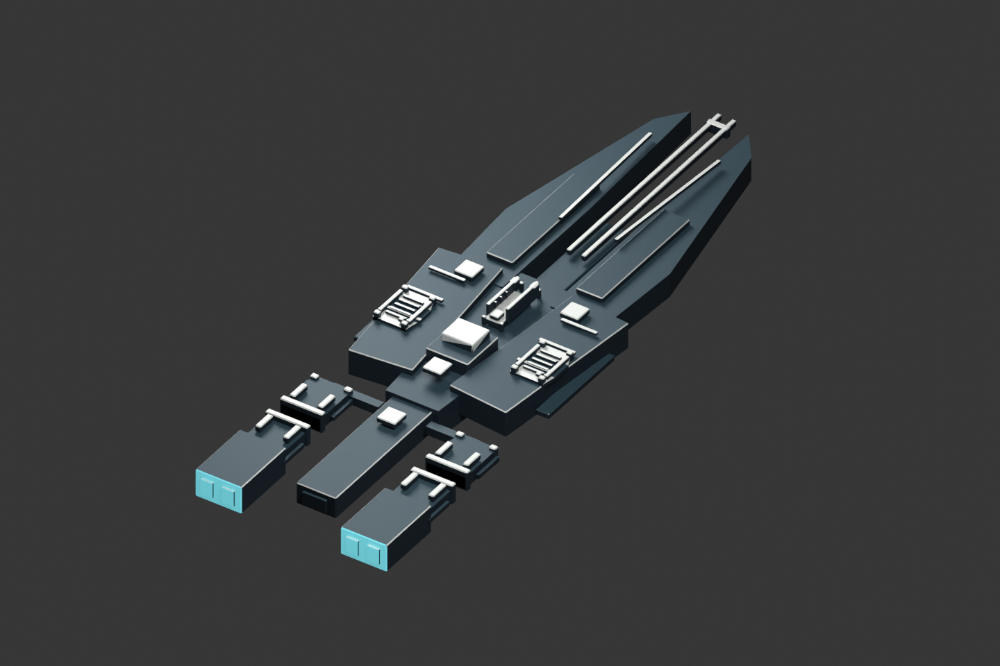
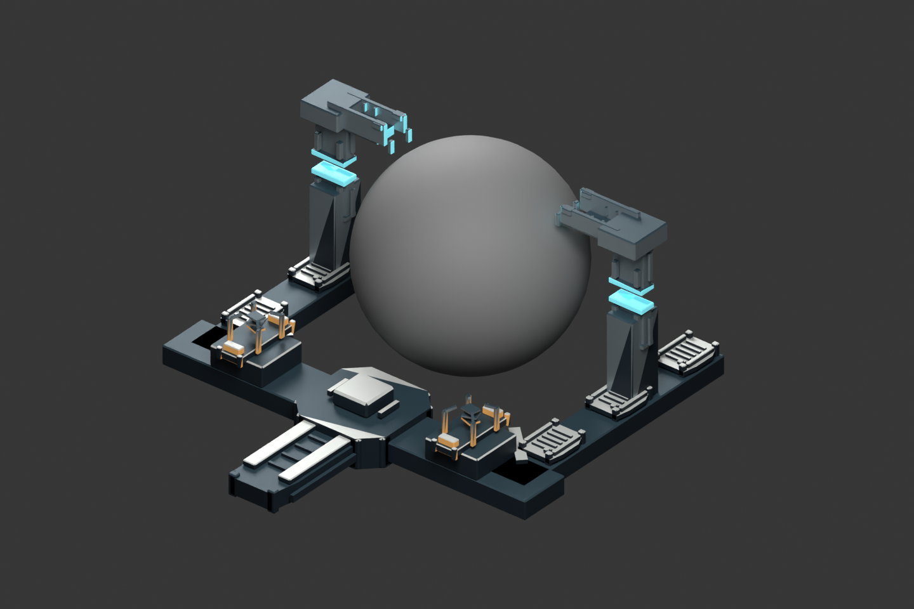

# 公共配色与材质离线研究 v0.1

2026-10-31，`draft_pending_human_review`，未安装到游戏。沿用已批准的[公共材质校准](../../../../docs/art/calibration/CENTRAL_COURT_MATERIAL_CALIBRATION.md)：深海军蓝/石墨蓝灰承接主体，暖灰白/雾银区分护板和结构，冷青用于正常运行端，琥珀用于维护侧。

本批只研究分区和质感，五个网格几何与原灰模保持一致。采用逐面规则和Blender节点材质，没有制作正式UV图集/游戏DDS，也没有把当前轮廓记为已批准。亮部与金属参数是离线研究值，颜色采用sRGB到线性转换；清单中的面面积统计不等于画面注意力占比、色比验收或游戏曝光通过。

[源文件](central_court_material_study_v01.blend)已实际重开并核对五网格面数；[分区清单](material_study_manifest.json)保存颜色/面积/来源。原[整体灰模](../README.md)保留；不从本研究文件直接导出正式运行材质。

重建：在项目根目录以独立后台运行`G:\blender\blender.exe --background --factory-startup --python-exit-code 1 --python tools/art/render_central_court_material_study.py`。拒绝用户交互场景或已打开文件；只读取项目灰模并另存新文件。

下一步先按轮廓与配色反馈收敛具体外观，再制作正式材质通道、LOD、效果与必要游戏显示。当前不改变角色/数值/造境玩法，F08/D12玩法状态保持未验。
