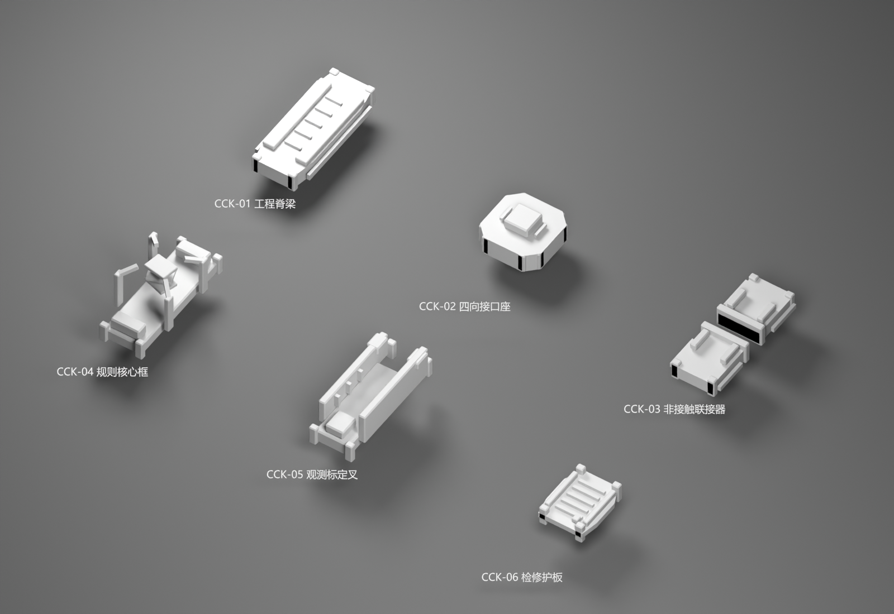

# 中央庭神器工程 Kit 灰模 v0.1

2026-10-31。状态：`draft_pending_human_review`，`runtime_installed = false`。这是可导出的公共部件候选，不是完整舰船/巨构的外观定稿。[共同视觉规范](../../../docs/art/ARTIFACT_CIVILIZATION_3D_VISUAL_LANGUAGE_v0.1.md)。



## 交付与边界

六个新建几何部件，合计2908三角面；一套线性作业链、一套侧站组合，7处主接口连接；四张离线预览。提供[Blender源文件](central_court_kit_v01.blend)、[清单](kit_manifest.json)及[磁盘重开结果](saved_blend_check.json)。

| 编号 | 部件 | 三角面 | 定位器数 |
| --- | --- | ---: | ---: |
| CCK-01 | 工程脊梁 | 376 | 3 |
| CCK-02 | 四向接口座 | 448 | 5 |
| CCK-03 | 非接触联接器 | 512 | 3 |
| CCK-04 | 规则核心框 | 664 | 3 |
| CCK-05 | 观测标定叉 | 512 | 3 |
| CCK-06 | 检修护板 | 396 | 3 |

`export/`含六个PDX网格、三张项目自产灰模DDS和一个GFX注册样品；这些样品仍在美术目录，没有复制进`mod/`。所有网格/材质/定位器名均完成PDX回读，原点与接口用于继续组装。两套组合是工程用法示例，没有安装舰种或巨构entity。

## 接口

`+Y`向前、`+Z`向上，接口宽2.4建模单位；`cc_in/cc_out`相对，四向座增加左右口。非接触件内部净空0.9，实际几何无穿过中心间隙的边。七处装配最大位置误差5.72e-07，法向相对；这不是游戏尺度或碰撞验证。

Blender中分“原点部件库”和“灰模评审”两个场景；原点库六个集合已标记资产，可分别追加到后续模型。评审场景包含16个集合实例，按一览/线性/侧站切换；实例不是游戏实体层级。源文件已在独立进程重开，三个项目DDS内嵌，无外部Blend库依赖。中文标注使用本机微软雅黑路径，字体没有打包再分发；其他电脑可用`--font`传入合适中文字体重新渲染。

## 离线预览

- [纯色剪影](previews/kit_silhouette.png)：看主轮廓与负形。
- [线性作业链](previews/assembly_linear.png)：同一接口串接承载、联接、核心和测量。
- [侧站组合](previews/assembly_station.png)：同一部件库的第二种用途。

预览统一灰/黑材质，不把配色当作辨识度证明；源文件保留可导出的灰贴图材质。与原版具体造型的目视对照、正式材质、LOD、游戏定位/尺度与显示仍待做。

## 重建

仅在项目根目录以独立后台、未载入用户文件的`factory-startup`场景运行。脚本在交互Blender或已打开文件中会主动拒绝执行。

```powershell
& 'G:\blender\blender.exe' --background --factory-startup --python tools/art/build_central_court_kit.py -- --pdx-addon-root 'C:\Users\Admin\AppData\Roaming\Blender Foundation\Blender\5.1\extensions\user_default'
```

构建末尾自动重开新源文件核对保存结果。只重开检查可在同一命令末尾加`--verify-saved`。沿用已安装io_pdx_mesh与项目灰模导出助手，不复制插件或原版几何。原有旗舰/枢纽样品、用户交互场景及独立连续巨构原型没有修改。
