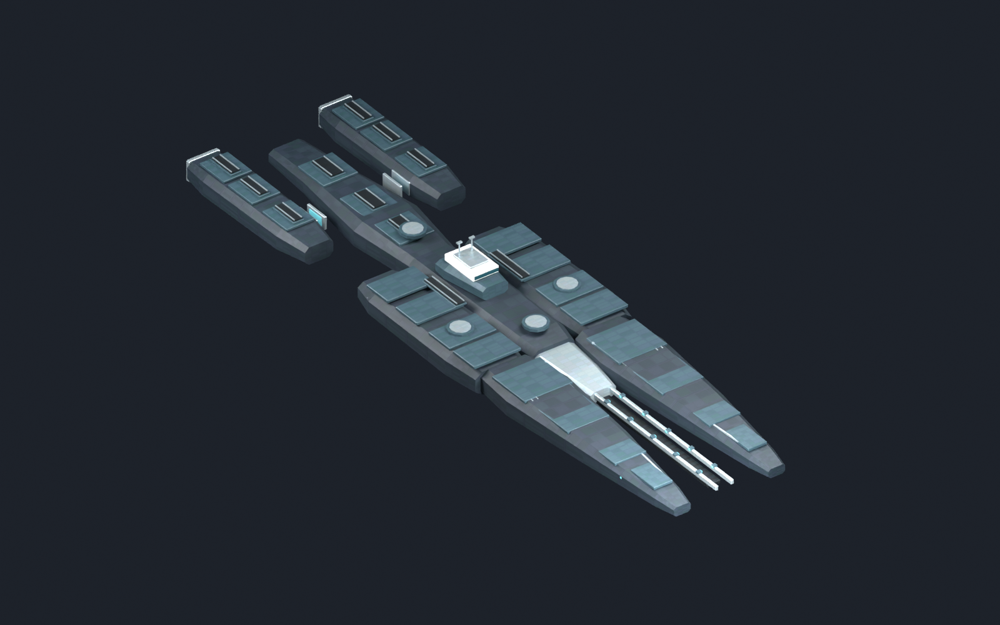
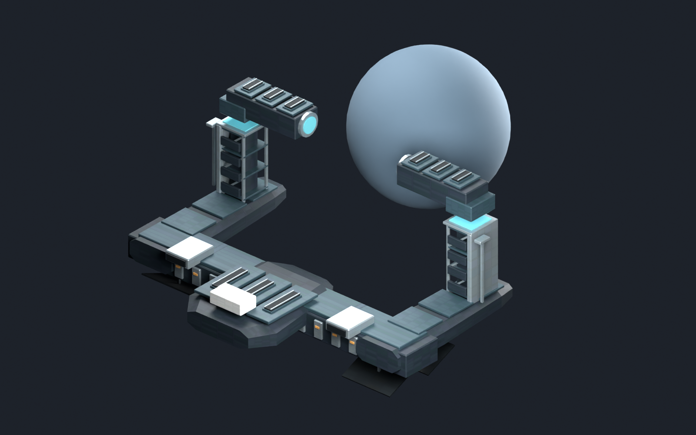

# 中庭级与传承造境平台：材质候选v02

2026-11-01，`draft_pending_human_review`，`runtime_installed=false`。在原灰模/配色研究和[概念方向](../../concepts/central_court_completion_preview_20261031/README.md)上推进实际模型制作；不是概念板的完成细节复刻，也未视为正式外观批准。

后续接入：本页记录作者空间批次；原文件保持。另由[独立转换批次](../central_court_runtime_v02/README.md)修正原生朝向并将7主网格接入Mod。其显示结果与当前接入状态另记，不能用本页历史`runtime_installed=false`替代后续批次状态。





## 本批内容

中庭级补齐既有全部5种区段：普通2L舰首、传承1X舰首、炮击3L中段、航母2H/2S/2PD中段和1L舰尾。三段共用原点，可组合成现有四种构型，武器槽/数值保持。装甲切面、分层护板、机库开口、舰桥、散热与分离式推进舱形成可读功能区；炮位只制作承载座，炮塔由原生组件挂接，不把示意炮管重复烘焙进舰体。

[普通舰首＋航母中段](previews/cruiser_standard_carrier.png)。本次两张舰图是离线模型渲染，没有添加引擎实际炮塔、开火或尾焰，不是游戏截图。

造境平台[基址](previews/worldformer_foundation.png)与运行态共用施工底座、物料接口和散热区。运行态增加外露承力架、设备芯、检修面、成对作用端与行星作业横梁；上下半体留有实际净空。场效、展开动画及移动设备尚未制作。球体仅为自行生成的比例参照，不在导出网格中，不表示已在引擎中环抱真实星球。

| 部件 | 主网格三角面 | 远景1 | 远景2 |
| --- | ---: | ---: | ---: |
| 普通舰首 | 1068 | 534 | 244 |
| 传承舰首 | 1696 | 848 | 390 |
| 炮击中段 | 1196 | 598 | 274 |
| 航母中段 | 1684 | 842 | 386 |
| 舰尾 | 2008 | 1004 | 460 |
| 造境基址 | 2120 | 1060 | 486 |
| 造境运行态 | 4720 | 2360 | 1084 |

共7主网格、14独立远景替代网格，每网格一个材质。传承炮击整舰4900三角面，普通航母4760三角面，不含原生武器等附属实体。远景文件尚未接入引擎自动距离切换，文件数量不等于同时绘制数量，也不构成帧率验证。

## 材质与源文件

3张2048×1024的DXT5/BC3 DDS共享图集，各含12级完整mip；对应PNG生成源保留。配色职责沿[批准公共校准](../../../docs/art/calibration/CENTRAL_COURT_MATERIAL_CALIBRATION.md)，未从概念图、原版或旧旗舰/旧塔采样纹理。

- Diffuse表达材质色块；Properties为R零重着色遮罩/G高光/B金属度/A光泽；Normal为G法线X/A翻转Y/B功能发光。
- UV按8个材料格投影，每格内缩5%；属于共享材质图集，不是独占UV高低模烘焙。接缝重复、远景材质和引擎曝光仍需实际判断，不能将完整mip当作视觉验收。
- [Blender源文件](central_court_surface_candidates_v02.blend)已实际重开，打包3张项目DDS，无外部Blend库；默认展示传承炮击构型，其他区段/远景/阶段隐藏保留。
- [模型清单](model_manifest.json)、[材质清单](surface_manifest.json)、[检查点](../../../reports/central_court_surface_v02_checkpoint_2026-11-01.json)。
- `export/`含21份PDX、共享PNG/DDS及独立GFX/7实体样品。路径拟为`gfx/models/central_court_surface_candidates_v02/`，尚未复制到Mod或替换实体引用。根舰体装配、LOD自动选择和推进/死亡/开火效果仍需接入。

PDX回读核对实际子网格、单材质/纹理引用与定位器；定位器名字覆盖现有区段声明。游戏尺度、方向、组件挂接和偏移尚未校准。具体轮廓/材质仍待评审；原版全面避撞、正式曝光与性能未验。

## 重建

只在独立后台factory-startup运行，不载入或修改用户当前Blender场景。本机Pillow12.3.0位于被Git忽略的`temp/cc_surface_v02_deps`；别的机器先提供可用Pillow目录，可用`--pillow-dir`指定。依赖不随Git提交。

```powershell
python -X utf8 -B tools/art/prepare_central_court_surface_v02.py
& 'G:\blender\blender.exe' --background --factory-startup --python-exit-code 1 --python tools/art/build_central_court_surface_v02.py -- --pdx-addon-root 'C:\Users\Admin\AppData\Roaming\Blender Foundation\Blender\5.1\extensions\user_default'
```

成功标记为`CC_SURFACE_V02_OK`和`CC_SURFACE_MODELS_V02_OK`，还需实际清单/源文件重开结果。脚本不写`mod/`，不启动游戏，不改个人舰/枢纽、天体级战舰范围或暂停原型。
