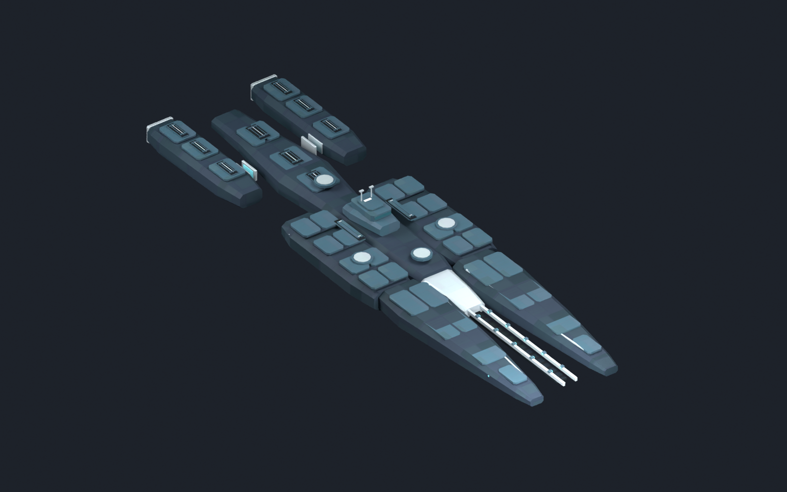
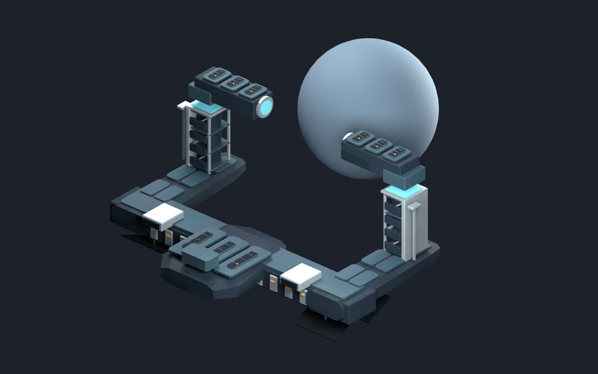

# 中庭级与造境平台：结构/材质精修候选v03

后续接入：本批六个部件已与v04新舰首合并为[v04开发运行包](../central_court_runtime_v04/README.md)，代表整舰已受控显示，见[运行检查点](../../../reports/central_court_v04_runtime_checkpoint_2026-11-01.json)。本目录仍保存作者空间批次及当时未安装的元数据；传承舰首改用后续v04，实际战斗、正常建造、平台显示与正式外观仍分别待验/待评审。

2026-11-01，`draft_pending_human_review`，`runtime_installed=false`。第一轮精修沿用现有公共配色、主轮廓与炮位/接口，不新增舰型、个人符号或玩法。本目录是离线候选，游戏内仍为已取得受控显示证据的[v02](../central_court_runtime_v02/README.md)。





## 这轮改动

- 67处装甲/甲板采用切角和上下分层，41处增加真实分盖接缝；护板顶高沿原尺寸组织，保留原炮座与接口净空。
- 重复的检修饰件分为舰面维护、推进散热、平台作业检修三类。新增轴向换热管、分盖/铰链、小型作业锁，保留明确用途。
- 舰桥/控制楼改用低反射深色外壳，小型识别饰面保留暖灰白；名义RGB不变，降低相应高光/光泽与工作端发光值。
- UV按面尺寸取用8格共享图集，薄边采样窄条；大面有封顶，仍保留5%格内缩。不是全模型等纹素密度、独占UV或高低模烘焙。
- 面板纹理改为较少、低对比的大分区和细加工纹理，减少小面上被拉伸的重复格子。Normal/Properties仍按既有Stellaris通道约定生成，3张2048×1024 BC3 DDS各含12级mip。

## 同条件对照

两版使用相同CYCLES灯光、镜头、曝光和16采样，并调用同一Specular G预览处理函数。旧文件只读入内存渲染，未保存回原文件；没有只给新版换灯光。

| 对象 | v02对照 | v03精修 |
| --- | --- | --- |
| 传承炮击整舰 | [v02同灯光](previews/v02_ship_same_lighting.png) | [v03](previews/ship_refined.png) |
| 造境运行态 | [v02同灯光](previews/v02_platform_same_lighting.png) | [v03](previews/platform_operational_refined.png) |

另有[普通舰首/航母构型](previews/carrier_refined.png)与[造境基址](previews/platform_foundation_refined.png)预览。全部为Blender离线渲染，材质解释是预览代理，不能当作游戏曝光已经验收。

## 文件与检查

| 主部件 | v02三角面 | v03三角面 |
| --- | ---: | ---: |
| 普通舰首 | 1068 | 1356 |
| 传承舰首 | 1696 | 1984 |
| 炮击中段 | 1196 | 1576 |
| 航母中段 | 1684 | 2064 |
| 舰尾 | 2008 | 2812 |
| 造境基址 | 2120 | 2444 |
| 造境运行态 | 4720 | 5164 |

传承炮击整舰6372三角面，普通航母6232，不含原生武器附件。7主网格及14远景替代共21份PDX，实际回读通过；每网格一个材质，7部件定位器的实际位置/旋转与v02完全一致，主网格UV在范围内。远景替代没有接入引擎自动切换，不作性能承诺。

[Blender源文件](central_court_surface_candidates_v03.blend)实际重开通过，打包3张项目DDS，无外部Blend库。原v02 Blender源文件、导出与运行资源均未改；共享辅助函数的可选前缀变化见下文。没有导入原版或旧舰/旧塔网格，也没有采样概念图像素。

- [精修清单](refinement_manifest.json)、[材质清单](surface_manifest.json)
- [结构化检查点](../../../reports/central_court_surface_v03_checkpoint_2026-11-01.json)、[实施记录](../../../reports/central_court_surface_v03_2026-11-01.md)
- `export/`保留21网格、3 PNG/3 DDS和GFX样品；未提供/安装游戏根实体或新效果。

仍采用作者空间+Y舰首/+Z上方。安装前必须沿已验证流程转换为原生方向并处理独立实体引用，不能直接用本目录文件覆盖当前Mod。正式外观、实际游戏曝光/尺度/效果和性能仍分别待验/待评审。

## 重建

只在独立后台factory-startup运行，不触及用户当前Blender交互场景。复用隔离Pillow12.3.0；本机普通沙盒若只见空包目录，使用允许读取依赖的执行环境，不重复安装。

```powershell
python -X utf8 -B tools/art/prepare_central_court_surface_v03.py
& 'G:\blender\blender.exe' --background --factory-startup --python-exit-code 1 --python tools/art/build_central_court_surface_v03.py -- --pdx-addon-root 'C:\Users\Admin\AppData\Roaming\Blender Foundation\Blender\5.1\extensions\user_default'
```

成功标记为`CC_SURFACE_V03_TEXTURES_OK`与`CC_V03_REFINEMENT_OK`，同时检查实际清单。共享v02材质函数只增加可选纹理前缀，默认仍为v02；其他已验流程保持。
