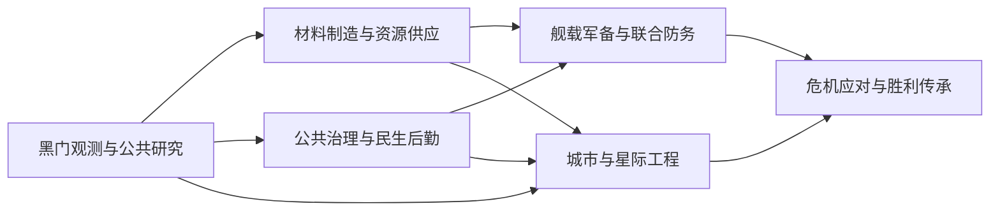

# 神器文明科技与建筑完整路线草案

**10月17日R2a更新：** 矿脉开发与循环回收2科技／2设施／2岗位已接入，公共现28科技／23建筑定义；运行待验。原矿站容量8→800为实质迁移，其他旧族未调整。R2按四个小包继续，见[R2a规格](artifact_civilization_r2a_implementation_spec_v0.1.md)。完整目标和图标暂停保持。

**10月17日运行更新：** R1观测—封存代表路径、一次正常升级及一次1／3进行态关键读档已通过；升级排他与月度载体索引错误已修复。最终成果单份、剩483日，就业与产出有实际证据；其他三方案、其他建筑族与平衡未验。最新结论以[本次记录](../../reports/artifact_civilization_r1_runtime_2026-10-17.md)及结构化规格的R1_runtime为准，下方10月14日“待验”为当时记录。当前公共26科技／21建筑定义不变，批量图标不恢复。

更新：2026-10-14。用户已确认先扩展完整科技与建筑路线，再继续大量绘制图标。原19项公共科技与15座建筑作为框架保留；本草案安排72项公共科技、27类公共建筑及其46个阶段，另列4项个人研究候选。R1七项研究、六座低级建筑及五类岗位已接入源码并通过静态核账，两类本地项目入口已实现；其余新增仍属设计；运行与平衡未验收。

本轮确定的是生产顺序和可审查的路线结构。72不是数量配额：后续若节点没有独立用途，应合并；若一种能力需要真正不同的研发步骤，可以拆分。既有六个图标目标候选保留，批量绘图暂停。

## 范围与数量口径

| 范围 | 原框架 | 完整路线草案 | 口径 |
| --- | --- | --- | --- |
| 公共科技 | 19 | 72，其中新增53 | 不含2项遗留兼容、4项个人候选及重复科技等级 |
| 公共建筑 | 15个定义 | 27类、46个阶段定义，其中新增31 | 升级阶段属于同一类；不是46种完全不同功能 |
| 爱缪莎个人研究 | 新路线未实现 | 4项候选，独立入口 | 不计入公共72项，不替代个人权限条件 |
| 传统与公共飞升 | 既有中央庭守望与2项公共飞升 | 保留制度与文明阶段接口 | 不为凑数追加飞升或传统树 |
| 图标 | 六个不同目标已有候选 | 暂停批量制作 | 19与15是原框架数量；R1后当前为26科技／21建筑定义，不作为1.0最终上限 |

科研与建筑是原版系统上的文明扩展，仍复用原版舰体、能源、研究抽取等基础；本路线不承诺替换整套原版科技。

## 发展过程与六个分支

前期先建立公共服务、标准件、标定和封存；中期形成专业观测、材料、舰载组件和城市分区；后期通过公共共鸣与终解阶段开放高级军备、规则接口和大型工程。最终危机检验这些公共能力，胜利后交付简短的奖励研发与结尾。研究发展过程不替换主线的五个剧情阶段。

| 分支 | 科技数 | 玩家得到的成长 |
| --- | --- | --- |
| A 黑门观测与公共研究 | 12 | 标定、封存、比对、预警，再开展有限边界实验。 |
| B 材料制造与资源供应 | 14 | 标准件、材料试验、量产、回收及战略预算形成连续选择。 |
| C 公共治理与民生后勤 | 12 | 民生、记忆、避难、联运和契约各有用途，危机前能提前准备。 |
| D 舰载军备与联合防务 | 14 | 武器、防护、探测、电脑、维修分别研究，形成舰队构筑选择。 |
| E 城市与星际工程 | 12 | 施工投入、城市分区、轨道接口、锚定和分段建造逐步开放。 |
| F 危机应对与胜利传承 | 8 | 识别、反制、冗余、危机中恢复，再获得公共科技、舰船和巨构奖励。 |

研究层级分布为：T1共5项，T2共10项，T3共15项，T4共20项，T5共22项。T不是剧情阶段；T5中同时有危机前准备和胜利奖励，额外门槛分别判断。层级先保持与现有19项一致，抽取权重、研究费用和实际时间在平衡包确定。

## 公共科技节点

编号仅用于路线审阅，不是准备写入游戏的科技键。“已有”表示对应旧定义继续存在，其扩展用途仍需实现；R1七项以“源码接入待运行”标记；其他新增节点未实现。前置为全部满足，额外门槛按下表解释。建设和行动还需支付各自费用并满足当地条件。

| 门槛代号 | 含义 |
| --- | --- |
| central_court_tradition_finished | 既有中央庭守望传统完成条件；保留原接口。 |
| vanilla_assault_armies_and_lasers | 既有原版突击军与激光科技；保留原字段。 |
| public_resonance_and_vanilla_combat_computers | 既有公共共鸣飞升及原版基础战斗电脑；保留原字段。 |
| public_apotheosis_and_vanilla_zero_point | 既有公共终解飞升及原版零点能源；保留原字段。 |
| common_crisis_contact | 新增设计概念：已接触最终危机的公共调查资格；不是现成脚本键，实施时映射既有公共危机状态。 |
| final_boss_common_victory | 新增设计概念：共同最终胜利记录；对三种合法结局一致，不读取个人正式转变。 |

六个分支按现有科研领域保留旧节点；表中的研究新节点不授予个人权限，也不改变已有主线结算。

### A 黑门观测与公共研究

将未知边界转为可复核的公共知识。

| 节点 | 科研领域与层级 | 前置 | 能力与解锁 |
| --- | --- | --- | --- |
| A01 塔罗演算（已有） | 物理 T1 | 文明身份与基础研究抽取 | 保留现有异常研究入口；为仪器标定、观测和治理分支提供共同起点。 |
| A02 黑门观测体系（已有） | 物理 T2 | A01 | 保留观测站、传感范围及既有锻造和经济研究资格。 |
| A03 基准观测与仪器标定（源码接入待运行） | 物理 T1 | A01 | 建设基准观测站，承担仪器标定与初级研究；后续升级到原黑门观测站，不另建标定所。 |
| A04 异常样本封存（源码接入待运行） | 物理 T1 | A03 | 开放样本保管库与有限批次封存项目；样本记录不新增全局资源。 |
| A05 多源异常比对 | 物理 T2 | A02＋A04 | 为观测设施开放多源比对能力，不新增同层实体建筑；保持观测站后续复核升级。 |
| A06 长基线高维测量 | 物理 T3 | A05 | 开放长基线阵列，支撑舰载测距和轨道观测工程。 |
| A07 相位扰动预警 | 物理 T3 | A05 | 升级传感阵列，提前显示已定义的异常风险与准备窗口。 |
| A08 受控边界实验 | 物理 T4 | A06＋B07 | 升级样本保管库，开放有限场地的边界实验；准备、实验与恢复分别记录。 |
| A09 跨殖民地观测联校 | 物理 T4 | A06＋C03 | 在选定的有限观测站之间完成联校项目；不逐日扫描全银河。 |
| A10 稳定规则接口 | 物理 T4 | A08＋B09 | 为规则锚定与有限压制提供可复核接口；不授予个人命运权限。 |
| A11 高维模型复核 | 物理 T5 | A09＋A10 | 观测站最终升级；允许复核危机观测模型及失败记录。 |
| A12 公共神器理论 | 物理 T5 | A11＋C10 | 把可重复的实验结论转为公共工程资格，接入危机反制路线。 |

实现方向：研究、建筑、选定目标决议与特殊项目；公共记录与个人命运身份隔离。
难度：中；异常窗口、项目产出及复现方式需逐项核实。
兼容与性能：只管理选定站点，避免逐日全银河遍历；不新增全局样本货币。

### B 材料制造与资源供应

神器研究建立在可维护的供给与制造体系上。

| 节点 | 科研领域与层级 | 前置 | 能力与解锁 |
| --- | --- | --- | --- |
| B01 神器锻造（已有） | 工程 T3 | A02 | 保留中央庭神器工坊及后续制造资格。 |
| B02 共鸣制造体系（已有） | 工程 T3 | B01 | 保留合金圣炉、工坊岗位和首都工坊已有工作量接口。 |
| B03 相位能源网（已有） | 物理 T4 | C02 | 保留相位反应堆及既有容量修正。 |
| B04 相位矿脉采掘（已有） | 工程 T4 | B02 | 保留相位矿脉稳定站及既有容量修正。 |
| B05 稀有共鸣精炼（已有） | 工程 T4 | B04＋B03 | 保留三类基础稀有资源精炼岗位。 |
| B06 前线维修与标准件（源码接入待运行） | 工程 T1 | A03 | 建设标准件工坊，为营建、舰载接口和后续神器锻造准备普通工程基础。 |
| B07 共鸣材料筛选（源码接入待运行） | 工程 T2 | B06＋A04 | 在标准件工坊或原神器工坊中开放材料试制，不另建材料试验场；与营建共用有限本地项目入口。 |
| B08 共鸣制造质量控制 | 工程 T4 | B02＋B07 | 升级共鸣合金圣炉；提高稳定供给能力并承担更高维护，不追加无差别全局乘区。 |
| B09 低损耗相位传输 | 物理 T3 | B07＋A05 | 建设相位供能试验站，为后续能源网和规则接口提供供能基础。 |
| B10 精准矿脉测绘 | 工程 T2 | B07 | 建设矿脉测绘站，开发目标矿区后才能升级为既有稳定站。 |
| B11 分布式配给仓储 | 社会 T2 | B06＋C01 | 建设配给仓；为选定工程预留物资，取消时按明确规则返还或消耗。 |
| B12 副产物闭环利用 | 工程 T3 | B10＋C07 | 开放回收处理厂；以岗位、能源和维护换取副产物再利用。 |
| B13 稀有共鸣定向精炼 | 工程 T5 | B05＋B08 | 精炼所升级，选择主产物方案；切换有成本和恢复期，不同时叠满三类专精。 |
| B14 战略工程供应 | 工程 T5 | B08＋B11＋C11 | 建设工程物资集成场；为舰体和分段工程支付并锁定供应预算。 |

实现方向：建筑升级、岗位、维护、有限目标物资预留；新效果独立成包。
难度：中；升级链、在建与既有岗位兼容需处理。
兼容与性能：不重复全局产出乘区，不承诺未经验证的独立乘算；预留与返还禁止刷资源。

### C 公共治理与民生后勤

中央庭从城市公共服务发展为跨殖民地公共制度。

| 节点 | 科研领域与层级 | 前置 | 能力与解锁 |
| --- | --- | --- | --- |
| C01 中央庭调度协议（已有） | 社会 T2 | A01 | 保留法令经费和既有行政分支；新增下级调度及贸易联络设施的设计入口。 |
| C02 塔罗经济演算（已有） | 物理 T3 | A02＋C01 | 保留首都工坊、观测分析员岗位和共有经济研究资格。 |
| C03 七日后勤网络（已有） | 社会 T4 | C02＋B02＋门槛：central_court_tradition_finished | 保留调度中枢、记忆宫、凝聚力与C2原入口；不增加人物或新科技门槛。 |
| C04 交界商业网络（已有） | 社会 T4 | C01 | 保留交界商业塔及既有凝聚力修正。 |
| C05 神器民生产业（已有） | 工程 T4 | B02 | 保留神器民生工坊与消费品修正。 |
| C06 星海契约行政（已有） | 社会 T4 | C03＋C04 | 保留契约议事厅与法令经费。 |
| C07 殖民地公共服务（源码接入待运行） | 社会 T1 | A01 | 建设社区服务中心与基础民生工场，支持早期殖民地日常供给。 |
| C08 记忆档案编目（源码接入待运行） | 社会 T2 | C01＋A04 | 建设记忆档案室；管理公共记录，与危险样本和旧日神器档案分别存放。 |
| C09 风险分区与避难组织 | 社会 T3 | C02＋C07 | 为社区公共服务中心增加避难组织用途，不另建避难中心，不修改C2保护参数或前置。 |
| C10 公共研究复现协议 | 社会 T3 | C08＋A05 | 开放成果复现项目，明确研究提交、复核和归档；不读取个人转变。 |
| C11 跨殖民地联运 | 社会 T4 | C03＋B11 | 建设联运换装站，连接有限选定殖民地与大型工程供应。 |
| C12 文明契约共治 | 社会 T5 | C06＋C11 | 升级指挥中心和契约议事厅；允许有成本地调整公共运行方案。 |

实现方向：公共科技、建筑、政策或决议；C2既有入口、费用、时长和读档语义保留。
难度：中；新制度与现有工坊、C2分别核账。
兼容与性能：公共能力不要求角色等级、组合或个人转变；不靠新增永久全局修正覆盖全部差异。

### D 舰载军备与联合防务

文明军备由公共神器工程支撑，从编制发展为专业装备与有限场域。

| 节点 | 科研领域与层级 | 前置 | 能力与解锁 |
| --- | --- | --- | --- |
| D01 神器使战斗编制（已有） | 社会 T2 | 门槛：vanilla_assault_armies_and_lasers | 保留前期陆军与既有基础组件；后续拆分需单独迁移包，不能先撤销旧存档能力。 |
| D02 神器共鸣军备（已有） | 工程 T4 | D01＋门槛：public_resonance_and_vanilla_combat_computers | 保留中期陆军与已有组件；作为共鸣装备分支的文明阶段资格。 |
| D03 神器终解战争学（已有） | 工程 T5 | D02＋门槛：public_apotheosis_and_vanilla_zero_point | 保留后期陆军与已有组件；作为终解装备分支的文明阶段资格。 |
| D04 神器舰载接口 | 工程 T2 | D01＋B06 | 研发舰载适配与维护接口，为后续组件族提供独立研究入口。 |
| D05 相位测距阵列 | 物理 T3 | D04＋A06 | 研发观测型传感器，强调探测与射控；现有传感器键在迁移时保留。 |
| D06 近程共鸣武器 | 物理 T3 | D04＋B07 | 开放近距离武器族试制，保持射程和追踪取舍。 |
| D07 共鸣偏折防护 | 物理 T3 | D04＋B07 | 开放防护组件族试制；护盾与装甲有维护和适用场景区别。 |
| D08 长程相位投射 | 物理 T4 | D02＋D06＋B09 | 开放长距离武器升级，牺牲近程表现或追踪，不替代全部武器。 |
| D09 分层相位防御 | 物理 T4 | D02＋D07 | 开放分层防护与针对性加固，组件槽位和功耗构成取舍。 |
| D10 联合作战核心 | 社会 T4 | D02＋D05＋C11 | 开放不同交战距离的战斗电脑与后勤协同，避免一个核心覆盖所有职责。 |
| D11 战损回收与补给 | 工程 T4 | D02＋B12 | 开放战后维修和有上限的回收方案；不以舰船自毁循环产出资源。 |
| D12 有限场域压制 | 物理 T5 | D03＋A10 | 为少量指定平台提供付费、有限范围的压制行动；作用对象和持续方式待可行性核实。 |
| D13 终解舰体承载 | 工程 T5 | D03＋B14 | 提供高阶部件承载与公用特殊舰体的技术基础；不开放个人唯一舰。 |
| D14 文明联合防务 | 社会 T5 | D10＋C12 | 开放行星与星港联合防务方案，优先强化质量与部署，不靠无限扩舰。 |

实现方向：组件族、陆军、现有公共飞升资格和少量指定平台行动。
难度：中至高；旧科技总包向新分支的迁移必须先设计，范围压制待可行性检查。
兼容与性能：保留旧键与已有舰船设计，不在新增科技前撤掉旧能力；不以无限舰队数量释放后期强度。

### E 城市与星际工程

从可执行的城市工程成长为大型公共基础设施。

| 节点 | 科研领域与层级 | 前置 | 能力与解锁 |
| --- | --- | --- | --- |
| E01 命运经济矩阵（已有） | 物理 T4 | C03 | 保留经济演算院、研究尖塔及既有产业修正。 |
| E02 命运都市工程（已有） | 工程 T5 | E01＋C06 | 保留改造研究资格；执行仍要求公共终解飞升及现有行星条件和一次性上限。 |
| E03 殖民地模块化营建（源码接入待运行） | 工程 T2 | B06＋C07 | 在当地标准件工坊或原神器工坊中组织付费模块化营建，不另建低级营建站或免费生成建筑。 |
| E04 城市功能分区 | 社会 T3 | E03＋C02 | 建设城市经济演算室，选择科研、生产或民生方向的规划任务。 |
| E05 研究园区整合 | 物理 T3 | E04＋A06 | 建设公共研究园区；专业科研设施形成早期到高阶的升级链。 |
| E06 轨道协同工程 | 工程 T3 | E03＋A06 | 开放轨道接口及星港配套模块，连接地表观测和后续工程；不计入行星建筑数。 |
| E07 行星环境缓冲 | 社会 T4 | E04＋B09 | 建设环境缓冲站，以持续维护应对有限环境风险，不自动改造盖亚世界。 |
| E08 规则锚定工程 | 物理 T4 | E06＋A10 | 建设公共锚定试验场；不替代主线现实基线枢纽，不写个人授权事实。 |
| E09 分段大型工程 | 工程 T5 | E08＋B14 | 开放分阶段投入与大型营建场；巨构具体能力仍需对应责任卡。 |
| E10 公共战略舰体工程 | 工程 T5 | E09＋D13 | 提供公共战略舰体研究资格，与主线既有唯一旗舰及个人专属舰分开。 |
| E11 星系协同基础设施 | 工程 T5 | E09＋C12 | 提供跨星系工程的供给与调度资格；连续视觉原型仍按原计划另验。 |
| E12 文明工程统筹 | 社会 T5 | E02＋E11＋C12 | 统筹城市与大型工程预算；都市运行调整付费且不突破现有唯一都市上限。 |

实现方向：建筑、行星决议、星港模块、特殊项目及后续巨构责任卡。
难度：高；舰体与巨构能力、模型和运行链须分别实现。
兼容与性能：沿用命运都市唯一上限；不挪用主线旗舰或枢纽身份。连续巨构的视觉验证与原解锁边界保持独立。

### F 危机应对与胜利传承

公共知识与准备经受最终考验，胜利后形成可继承的成果。

| 节点 | 科研领域与层级 | 前置 | 能力与解锁 |
| --- | --- | --- | --- |
| F01 旧日神器档案修复（已有） | 社会 T5 | E01＋B05 | 保留旧日档案馆和小型文物岗位，作为公共知识保存而非个人记忆读取。 |
| F02 危机信号鉴别 | 物理 T5 | A11＋E08＋门槛：common_crisis_contact | 鉴别已接触的最终危机信号，开放公共预警和反制研究候选。 |
| F03 公共反制预案 | 社会 T5 | F02＋A12＋D14 | 建设危机联合防务中心，准备可部署的公共反制；不得要求个人终解。 |
| F04 应急工程冗余 | 工程 T5 | F02＋B14＋E09 | 锚定设施升级；为关键工程保留修复备件与冗余预算，不重置C2冷却。 |
| F05 文明联合恢复 | 社会 T5 | F03＋F04 | 建设灾后重建工场，在危机期间也能恢复受损殖民地；不要求先赢最终Boss。 |
| F06 灾后记录解译 | 物理 T5 | F01＋F05＋门槛：final_boss_common_victory | 升级旧日档案馆，解译共同胜利记录；所有合法结局共享入口。 |
| F07 终局舰船工程 | 工程 T5 | F06＋E10 | 交付胜利后的公共舰船奖励研发；缩短研究收尾，不再设置第二轮Boss。 |
| F08 终局巨构工程 | 工程 T5 | F06＋E11 | 交付胜利后的公共巨构奖励研发，与结尾收束；不打开新的长期危机循环。 |

实现方向：既有危机接口的概念门槛映射、选定目标项目、共同胜利标记与短程奖励研究。
难度：高；新机制及共同胜利记录与三结局衔接仍待实现。
兼容与性能：不提前授予完整个人权限；共通奖励不要求转变结局。胜利奖励后不新增第二轮Boss或长期危机链。

## 公共建筑与升级关系

本轮收敛：标定所合入观测站，材料试验场合入工坊，避难组织中心合入社区公共服务；E03营建也由工坊组织，不另建低级营建站。保留能力后，建筑由30类50阶段调整为27类46阶段；设计编号BL16／BL19／BL23停用，不涉及删除任何运行资源。

每行是一类建筑，箭头是拟定升级方向。括号内为研究节点，“已有键”表示现有建筑在该阶段保留身份。新低级建筑不会要求老存档拆除、降级或重建既有高级设施。各类建筑不要求在每颗行星全部建造，岗位、维护和建筑槽构成专业化选择。

| 建筑类 | 阶段与研究条件 | 独立用途 |
| --- | --- | --- |
| BL01 中央庭指挥 | 中央庭指挥中心（无需项目科技；已有键） → 中央庭统筹中心（C12） | 行政与公共运行方案；不代替契约协商。 |
| BL02 黑门观测 | 基准观测站（A03） → 黑门观测站（A02；已有键） → 高维观测复核站（A11） | 观测与异常模型比对；不生产材料。 |
| BL03 神器工坊 | 标准件工坊（B06） → 中央庭神器工坊（B01；已有键） | 标准件生产、材料试制与营建组织共用工坊，量产仍由合金炉承担。 |
| BL04 七日调度 | 调度联络站（C01） → 七日调度中枢（C03；已有键） | 调度与既有C2入口；不承担物理避难容量。 |
| BL05 经济演算 | 城市经济演算室（E04） → 命运经济演算院（E01；已有键） | 规划记录和公共经济试验；不与科研产出设施同质。 |
| BL06 公共研究园区 | 公共研究园区（E05） → 命运研究尖塔（E01；已有键） | 承担研究岗位与园区整合。 |
| BL07 共鸣合金 | 共鸣合金圣炉（B02；已有键） → 共鸣精密合金炉（B08） | 规模化合金生产，依赖供应与维护。 |
| BL08 民生制造 | 基础民生工场（C07） → 神器民生工坊（C05；已有键） | 日常消费品生产；公共服务中心提供服务。 |
| BL09 相位供能 | 相位供能试验站（B09） → 黑门相位反应堆（B03；已有键） | 从供能试验到高阶发电。 |
| BL10 交界贸易 | 交界贸易联络所（C01） → 交界商业塔（C04；已有键） | 市场与交易岗位，区别于行政契约。 |
| BL11 矿脉开发 | 矿脉测绘站（B10） → 相位矿脉稳定站（B04；已有键） | 先测绘再稳定采掘。 |
| BL12 稀有精炼 | 稀有共鸣精炼所（B05；已有键） → 定向共鸣精炼中心（B13） | 三类资源基础生产与有成本的方向专精。 |
| BL13 公共记忆档案 | 记忆档案室（C08） → 中央庭记忆宫（C03；已有键） | 公共记录和制度记忆，与危险样本及旧日文物分开。 |
| BL14 文明契约 | 星海契约议事厅（C06；已有键） → 文明共治议事院（C12） | 殖民地间公共规则、协商与运行方案。 |
| BL15 旧日神器档案 | 旧日神器档案馆（F01；已有键） → 文明传承档案馆（F06） | 既有小型文物岗位和共同胜利记录。 |
| BL17 异常样本保管 | 异常样本保管库（A04） → 受控边界实验室（A08） | 安全封存危险样本与受控实验。 |
| BL18 长基线传感 | 长基线传感阵列（A06） → 相位预警阵列（A07） | 探测与风险窗口；不直接等于战斗射控。 |
| BL20 物资配给 | 分布式配给仓（B11） | 针对选定工程的有限物资预留；不是无限全局储量。 |
| BL21 循环回收 | 循环回收处理厂（B12） | 岗位与维护换副产物回收，杜绝无成本循环。 |
| BL22 社区公共服务 | 社区公共服务中心（C07） | 社区公共服务；C09在同一设施中组织避难，不另建避难中心。 |
| BL24 殖民地联运 | 联运换装站（C11） | 有限节点之间换装与运输。 |
| BL25 环境缓冲 | 环境缓冲站（E07） | 限定风险的环境缓冲；不替代地貌改造。 |
| BL26 公共规则锚定 | 规则锚定试验场（E08） → 冗余规则锚定站（F04） | 公共试验及工程冗余；不占用主线基线枢纽的身份。 |
| BL27 危机联合防务 | 危机联合防务中心（F03） | 准备并部署公共反制，不授予个人命运权限。 |
| BL28 灾后重建 | 灾后重建工场（F05） | 危机中可用的本地修复与重建。 |
| BL29 战略物资集成 | 工程物资集成场（B14） | 大型舰体与工程的供给集成，区别于日常配给。 |
| BL30 模块化营建 | 大型工程营建场（E09） | 仅在E09后承担大型分段工程；E03低级营建由工坊组织。 |

同类各阶段共用数量限制；上级保留下级核心用途，升级替换岗位和效果，不允许把上下级同时建造来叠加收益。独立数量限制、行星适用条件及维护均以对应实现包为准，不能仅为升级链增加一座无用途建筑。

重复功能重点检查：公共记忆档案保存治理记录，异常样本库管理危险样本，旧日档案馆保存神器文物；工坊共用材料试制与营建组织，合金炉负责量产；配给仓负责本地物资、联运站负责节点运输、工程集成场服务战略建设。若实际玩法无法区分这些职责，合并后再制作图标。

星港模块、轨道接口、巨构阶段和舰船分段不计入这46个行星建筑定义。P线个人工程的建筑或设施数量也未混入。

## 军备研究与现有总包的衔接

现有D01、D02、D03同时解锁多类组件。新增路线把接口、探测、近程、远程、防护、电脑与维修拆成可选择的研究方向；组件数量及各型性能另在军备包登记，不把每个武器尺寸都算成一项新科技。

实施先增加有不同职责的组件变体，保留现有组件键、舰船设计和已获能力。把三个总包进一步收敛为阶段资格，必须在独立迁移方案明确后进行：新档和旧档分别记录，不能先撤掉旧解锁再要求补研，也不批量免费授予全部53项新研究。未落实迁移前，三个旧总包维持原行为。

不同武器和防护应具有射程、追踪、功耗、槽位、维护或目标适用性的取舍。高阶装备提高质量与战术能力，不把海军容量和舰船数量无限膨胀作为主要成长。

## 公共工程与危机边界

- C2已经通过用户限定的正常启动和一次保护期读档。继续保留七日后勤网络、当地中枢及实际控制等入口，1000能源／500消费品准备、180日25%保护和既有整备期限；本轮不改数值、不加新前置、不重测。
- 命运都市仍通过现有科技、公共终解飞升和行星条件执行，帝国一次性上限不变。E12只规划运行统筹，不自动开放第二座都市。
- 既有危机旗舰与现实基线枢纽的主线授权、唯一身份和恢复机制保留。E08、E10提供新增公共能力，不把它们当成已交付新舰或原枢纽的免费替身。
- 跨星系连续巨构保持原验证顺序：一个低复杂度、带方向标记的静态长条，通过后才验证三截面，再进入正式造型与玩法。复用缩放与基础保存证据，不重复倍率或穷举。E11和F08不改变它既定的第五阶段解锁边界，也不自动开始验证或模型制作。
- F02的接触资格与F06的共同胜利资格是设计门槛，不是现成脚本键。实现时对应既有公共危机状态，不能误用爱缪莎个人转变结算。
- F05在危机期间即可帮助恢复，不能把重建锁到胜利后。F06～F08承接共同胜利，无需选择转变结局；研究收尾保持简短，后续普通游玩可使用奖励，不再新开长期危机或第二轮Boss。
- 新研究不是现有主线的新增必需门槛。后续难度设计可以利用公共反制能力，但不能要求旧存档重跑已经完成的章节，也不要求每项非主干科技全部研究后才能推进剧情。

## 爱缪莎个人研究的独立路线

仅主线第五阶段全部结束、玩家最终授权、爱缪莎自主接受并合法完成正式转变结算后；沿用aemusa_ms_country_ending_fate_sovereign_settled及既有身份与授权检查。

结尾后的可选短程奖励研究；入口与配方可随合法结算开放，不新增强制长任务链或第二轮危机。

| 个人节点 | 前置 | 拟定用途 |
| --- | --- | --- |
| P01 可能性分支建模 | 合法正式转变结算 | 查看本Mod当前合法工程的候选方案与明确代价；不改写已结算历史。 |
| P02 选定方案重组 | P01 | 在有限指定工程中付费切换未结算方案；已消耗资源、冷却与结果不可回滚刷取。 |
| P03 命运舰体接口 | P01 | 个人专属舰船或核心的研究资格；公共舰体工程可在建造阶段单向核对，不替代现有主线唯一旗舰。 |
| P04 可能性工程接口 | P01 | 个人专属工程配方资格；公共工程条件可在建造时核对。具体巨构能力与数量另定，不自动认领连续巨构原型。 |

不以30级、旧个人飞升或两项遗留科技代替入口；公共72项及共同胜利奖励不反向依赖P线。

这些是Mod能力候选，不是新增原作事实。方案重组只面向尚未结算、由本Mod管理的有限工程；资源守恒、权限校验和舰体／工程实现均需核实。个人舰船和巨构的数量、能力与造型不在本轮定稿。人物组合仍暂停。

## 费用与研究抽取原则

保留现有19项费用与抽取规则。新增普通研究参考同层原版和现有文明科技的实际时间，少量突破研究可较昂贵；不要同时叠加高费用、稀有抽取、多事件门槛和必需角色，造成长时间无选择。基础民生、标定和标准件在前期可用，新增公共内容统一读取文明身份。

建设与升级消耗真实资源并保留岗位和维护成本；预留供应、实验、避难、施工和方案切换各自核账。新科技优先解锁设施、组件、目标行动或明确的运行方式；只有量变且与相邻节点不可区分的研究应合并。胜利奖励不能再要求漫长常规科研才能看到内容。

## 存档与旧定义保留

结构化清单逐项记录19个科技旧键与15个建筑旧键。已有科技的层级、科研领域和项目内前置已与脚本核对；原19项科技数值与前置保持，R1新增内容另见具体规格。

建筑若作为升级链中段，旧键仍处在原等级，旧存档不补造低级建筑。实施时用组内排他条件与升级字段处理并存，防止岗位和修正双计。移民、占领、在建升级、旧条件缺失的处理只在受影响实现包检查，不恢复全Mod穷举。

2项遗留科技与既有个人飞升继续独立兼容，不并入新公共节点，也不代替P线。资料来源是本项目当前定义及已确认的1.0范围；新名称为设计暂名。

## 实施顺序与图标恢复条件

| 分包 | 交付范围 | 本包应形成的体验 |
| --- | --- | --- |
| R0 路线与迁移设计 | 本草案、节点用途、建筑职责、既有键映射 | 先收敛重复功能、解锁顺序与命名；本轮交付 |
| R1 前期专业基础 | A03／A04、B06／B07、C07／C08、E03及直接关联低级建筑 | 从公共服务和标准件进入标定、封存与材料试制，不要求人物组合 |
| R2 中期研究与城市 | A05～A07、B09～B12、C09／C10、E04～E07 | 可选择殖民地科研、生产和后勤分工，形成建筑升级链 |
| R3 军备分化与制度成长 | D04～D11、B08／B13、C11／C12 | 拆开装备职责，落实总包迁移与联运维护；不撤旧存档能力 |
| R4 大型公共工程 | A08～A12、B14、D12～D14、E08～E12 | 高阶实验、舰体和分段工程能开展具体行动；巨构按原边界另验 |
| R5 危机与结尾 | F02～F08，P线单独交付 | 公共危机准备、恢复与三结局共有奖励；个人研究仅合法转变后开放 |

R编号是实施分包，不是剧情阶段。分包可按依赖再拆小，不机械一次性实现整行。R4与R5涉及的新玩法先补责任卡和可行性核实，成本、强度、奖励舰船与巨构数量随对应包收敛。

批量图标恢复前，应确定选定实现批次的节点身份、名称、用途、层级和建筑升级关系，并确认没有重复设施。无需等全部72项代码完成后才制作资产；只为已收敛的批次恢复生产。现有候选可继续复用为风格参照，黑门的晶片／碎片感调整随对应资产批次处理，不抢占当前路线工作。

每个新增玩法包只做必要静态检查、一条正常新增流程、一次有保存语义的关键读档及当包严重失败点检查；复用已完成证据，发布前再做一次整体衔接回归。本轮接齐R1基础及本地项目并完成静态核账与12项新项目检查，源码阶段未操作游戏。

## 核对与依据

- 72项公共节点、六分支数量、53项新增与19项旧键覆盖一致；前置引用存在、无环，研究层级未出现倒挂。
- 27类建筑共46个阶段，旧15个键各出现一次；各升级链的研究层级不下降。P线4项另计，不进入公共前置图。
- 保留公共与个人研究分离、人物组合暂停、C2完成和连续巨构既定边界；R1新增脚本与引用已接入；六个目标图标母版／DDS未改动，没有批量出图。
- 数量比较仅作量级参考：[Guilli’s Technologies](https://steamcommunity.com/sharedfiles/filedetails/?id=1793768254)作者标注125项新增科技；[ACOT](https://steamcommunity.com/sharedfiles/filedetails/?id=1419304439)标注超过699项。巨构作者仓库2026-10-07提交`436812fb3acd9dc7d6cb5e666268a3a1d8135aa7`统计306个显式科技定义、123个显式行星建筑定义；含升级、重复、特殊阵营或覆盖项，建筑另有8处模板调用未展开，不是净新增或单局总量。[巨构源码](https://github.com/Pouchkinn-s-Gigastructures/Gigastructures)。

本路线数据：[结构化清单](artifact_civilization_research_building_route_v0.2.json)。当前已实现用途仍以[原文明路线](../mechanics/artifact_civilization_route_v0.1.md)为准；1.0交付与结尾范围见[范围确认](artifact_civilization_1_0_scope_confirmation_2026-10-08.md)，两条研究线的权限边界见[分离记录](../../reports/artifact_technology_separation_2026-10-10.md)。

R1具体费用、岗位、项目状态与分包见[第一包实施规格](artifact_civilization_r1_implementation_spec_v0.1.md)及其结构化清单。

R1源码接入结果与待验范围见[整包续接](../../reports/artifact_civilization_r1b_implementation_2026-10-14.md)；当前公共科技26项、行星建筑21个定义，目标路线规模仍为72项及27类46阶段。

10月14日另有轻量运行与图标引用修复：A03完成，A04及观测站在建，项目和关键读档仍待验；已保存2255.06.09测试分支。见[运行续接](../../reports/artifact_civilization_r1_runtime_2026-10-14.md)。
