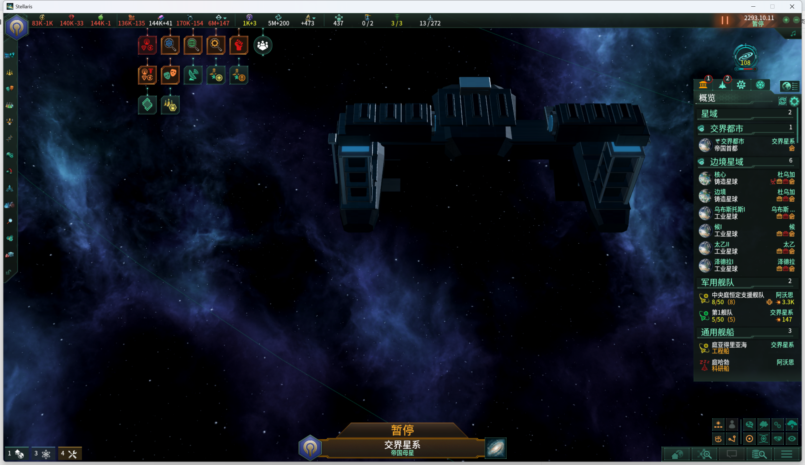

# v02模型受控显示与扫描码续接

2026-11-01，源基线`9da6b5f`。复用已有14144进程及暂停的reserve，本轮未重启或重新载档。当前只使用原生守卫后端，未混用Computer Use输入。

## 已观察

- 普通沙盒无法识别真实群星桌面窗口；桌面权限环境的Inspect可见唯一已知路径进程。重新识别为PID14144/窗口199536，前台曾为msedge；这些编号仅为本轮证据，后续仍重新核实。
- 同次置前和100ms扫描码成功打开控制台。游戏仍暂停在2293.10.11，控制台原输入行为空。
- 为确认本机实体显示语法，新准备`help spawnentity`，没有重放旧help诊断、审计、资源或剧情命令。第一次输入出现拼音候选，未回车且清空；分次Shift后再输入仍出现拼音，同样未提交、已清空。
- 新增可选`-ToggleImeBeforeText`，只在Text分支中同次发送Shift并输入；默认关闭，所有焦点/修饰键/部分文本/独立提交守卫保持。调用后画面出现ASCII片段`he`，但中途失焦，守卫停止。记录Attempted=3，画面为两空格加he共4字符，按既有有界清理移除并看图确认空白。
- 该参数尚未完成整行/回车运行验证，不能称自动输入全面修复。脚本语法和既有9项清理守卫源码检查通过，检查本身不发送桌面输入。

## 用户准备后的实际结果

用户回复“准备好了”并提供英文/前台条件后，三条命令均由原有Text接口完整输入、看图核对后独立Submit成功；这些成功调用没有使用新增ToggleIme参数：

1. `help spawnentity`：实际回显`spawnentity [<entity name>]`，说明在鼠标位置生成显示实体。
2. `spawnentity ccv02_preview_spinal_artillery_entity`：完整51字符输入（含前导空格），实际回显`Spawned Entity!`；未取得清晰整舰画面，不能标记组合模型显示通过。
3. `spawnentity ccv02_runtime_worldformer_active_entity`：完整53字符输入，实际回显`Spawned Entity!`；同次操作中先将指针定位到空白星域再Submit，随后收起控制台，运行态平台网格与材质在游戏中清晰可见。

[结构化检查点](central_court_v02_display_checkpoint_2026-11-01.json)。这是一例4.5.2(04ef)的受控实体显示，证明平台运行态的基础渲染链可用；没有建造真实巨构、创建可作战舰船或写入剧情进度。正常建造/轨道位置/星球旁尺度、整舰组合、炮塔/尾焰/死亡效果和正式曝光仍未验。没有扩测航母/基址，未用的准备文件不是执行队列。

整舰命令虽成功，输入过程中镜头/指针位置仍可能改变；这只是候选解释，尚未证明组合实体有问题。下次若需复查，沿平台成功方式在核对文字后定位鼠标并Submit，只处理整舰取景/尺度/挂接，不重做键盘排障或冷启动。

## 保存与最终状态

最后观察为2293.10.11暂停，控制台及Debug View关闭，两个受控显示实体留在当前场景；没有待提交输入。没有推进时间、创建新游戏档或覆盖reserve，原档仍为2,573,589字节。原始截图在被Git忽略的`tools/desktop/ccv02_*.png`，关键平台画面已复制到本报告的images目录，未经裁切或重绘。

本轮Mod资源/玩法源码保持；资产登记仅将平台运行态更新为受控显示已观察，外观与再分发审核状态不变。输入脚本的可选参数仍须先确认拼音模式/空行，默认关闭且尚未完成整行运行验证；只有最终ASCII确实匹配时才能独立Submit，失焦/修饰键守卫均保持。记录与中文checkpoint提交后可续接，不要求用户再次启动、载档或补交旧命令。
