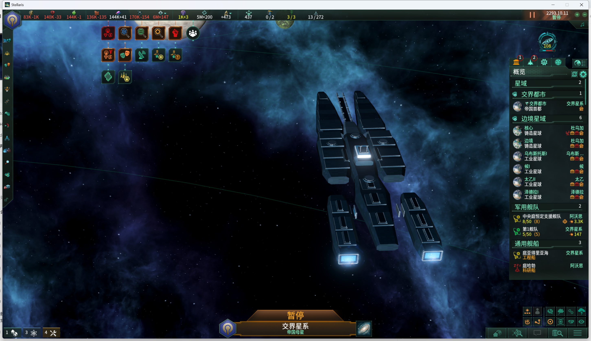

# 中庭级传承炮击组合：游戏内基础显示

2026-11-01，续接基线`12198c4`，模型资源对应`9da6b5f`。此前整舰命令只有生成回显，本轮复用平台已成功的定位方式，实际取得清晰整舰画面；没有改写组合架构或模型资源。

## 本轮结果

同一4.5.2(04ef)进程，未重新启动/载档，始终暂停2293.10.11。沿现有原生扫描码入口，完整输入51字符命令（含两前导空格），看图核对后，在同次调用中将鼠标定位到当前空白星域、独立Submit并收起控制台。

命令为`spawnentity ccv02_preview_spinal_artillery_entity`，实际回显`Spawned Entity!`。传承舰首、炮击中段和舰尾的组合、双叉舰首/中轴导轨、肩甲、舰桥与分离推进舱均在画面可见；略微放大镜头后保存原始截图。推进工作端亮部可见，不单独据此认定尾焰粒子或推进效果通过。

这证明既有组合实体可以在受控显示中渲染。先前不清晰的具体原因未定，不能据先前画面推断模型损坏或需要重写根实体。没有重做help、输入模式排障或其他构型。

## 证据边界

- 仅验证一套传承炮击组合的基础网格/材质显示；[运行态平台基础显示](central_court_v02_display_2026-11-01.md)直接复用。
- 生成的是调试显示实体，未创建可作战舰船或真实巨构。炮座属于模型，真实炮塔等组件由正常舰船配装挂接；当前画面不证明实际装配、开火、移动、尾焰、死亡或战斗通过。
- 没有校准与原版舰船的正常场景相对尺度，也未扩测普通舰首/航母或自动LOD；具体外观、材质曝光与发布审核保持待确认。
- 本轮未改变Mod资源或玩法源码；已有静态/源码检查复用，没有新增测试或重复全套检查。

[结构化检查点](central_court_v02_ship_display_checkpoint_2026-11-01.json)记录输入、图像及相关日志结果。原始截图未经裁切、补光或重绘。资产登记只更新所观察的三个区段和实体包的受控显示状态，不提升外观或再分发权限。

## 保存与下一步

当前仍暂停2293.10.11，控制台/Debug View关闭，无待提交输入。调试显示对象留在当前场景；未推进时间、存档或覆盖reserve，原文件仍为2,573,589字节，修改时间2026-10-31 13:12:14.479658+08:00。句柄/PID只保留为历史证据，后续重新识别。

一舰一构的基础显示已取得实际画面，下一步回到轮廓、材质层次和细节精修；正常配装/造舰及平台建设/轨道尺度并入后续一次阶段代表试玩，不重复本次显示准备。正式外观与发布范围仍单独确认。
